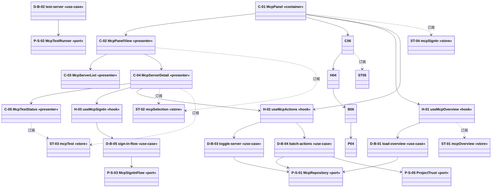

# 组件与静态视图 — C-G / `McpConfig.tsx`

> 目标：给开发与测试看的**静态结构**。图先给依赖关系，表再给每个元素的边界与落点。
> 校验：`design-gate.mjs --run .evo/migration/20261022-C-G-mcp --design-only`（D2/D3/D8/D9/D11/D12/D13/D14/D16/D17/D18）

## 1. 静态视图（UML 类图）

**三句话读法**

1. `-->` 是依赖方向：容器 → 展示 → hook → 用例 → 端口，没有反向边；**展示组件不持有用例**。
2. `..>` 是订阅方向：store 只被订阅，不被组件直接写；写只发生在 hook 里。
3. 测试落点：`C-03/C-05` 是纯 props 渲染（L3 组件测试）；`D-B-0x` 是纯函数（L2 用例测试，用 `P-S-0x` 的桩）；`ST-0x` 是状态迁移（L2 状态测试）。

## 2. 元素清单

| 元素 | 型 | 落点 | 负责什么 | **不负责什么** |
|---|---|---|---|---|
| C-01 | 容器 | `mcp-panel.tsx` | 持有页面级 store 引用、消费 3 个 hook、把 props 下发 | 不做布局细节，不直接发请求 |
| C-02 | 展示 | `mcp-panel-view.tsx` | 三栏布局骨架、把分组与选中项摆位 | 不读服务端数据（全由 props 给） |
| C-03 | 展示 | `mcp-server-list.tsx` | 分组列表、组头批量开关、chips | 不计算测试状态 |
| C-04 | 展示 | `mcp-server-detail.tsx` | 详情、行内改名、移除确认、测试按钮 | 不持有轮询定时器（在 H-03） |
| C-05 | 展示 | `mcp-test-status.tsx` | 测试状态与日志展示、展开更多 | 不发起测试 |

## 3. hook 清单

| hook | 签名 | 替换源码 | 被谁用 | 调哪些端口 |
|---|---|---|---|---|
| H-01 | `useMcpOverview({cwd, repository}): {overview, error, loading, groups, reload}` | `McpConfig.tsx#L295-L560` | C-01 | `P-S-01` |
| H-02 | `useMcpActions({repository, testRunner}): {toggle, batchToggle, add, remove, undo}` | `McpConfig.tsx#L560-L831` | C-01、C-04 | `P-S-01`、`P-S-02`、`P-S-05` |
| H-03 | `useMcpSignIn({flow}): {state, start, pasteRedirect, cancel}` | `McpConfig.tsx#L600-L700` | C-04 | `P-S-03` |

## 4. store 清单

| store | state | 持有者 | 订阅者 | 生命周期 |
|---|---|---|---|---|
| ST-01 `mcpOverview` | `overview` / `overviewError` / `loading` / `groups` / `requestRef` | D-U-03 | C-01、C-02、C-03 | 面板挂载期间；`cwd` 变化触发重载 |
| ST-02 `mcpSelection` | `selectedKey` | D-U-03 | C-01、C-02、C-04 | 跨刷新：持久化到 `settings-navigation.getLastSettingsSelection("mcp", cwd)` |
| ST-03 `mcpTest` | `testRequestsRef` / `testResults` / `undo` / `added` | D-U-03 | C-04、C-05 | 面板挂载期间；`undo` 到点自清 |
| ST-04 `mcpSignIn` | `signInFlow` / `signInPoll` / `trustState` | D-U-03 | C-01、C-04 | 签到结束或卸载；**卸载不取消服务端流程** |

## 5. 最佳实践落地

| 实践 | 落在哪 | 做到什么程度 |
|---|---|---|
| 容器/展示分离 | C-01 vs C-02/C-03/C-04/C-05 | 容器只持有 store 与 hook；展示组件不 import 端口、不 import 用例 |
| 状态就近 | ST-01、ST-02、ST-03、ST-04 | 4 个 store 按生命周期分：overview/selection/test/signin；页面级不放局部状态 |
| 派生状态不落库 | ST-01 | `groups` 由 `overview` + `useMemo` 派生，不写入 store，也不持久化 |
| 渲染优化 | C-03 | 列表项按 `useCallback` 稳定 `onToggle`，行级 memo 只比较 `server.key` + `enabled` |
| 列表 key | C-03 | key 用 `scope + "/" + name`（服务唯一标识），不用索引 |
| 可访问性 | C-05、C-04 | 状态用 `aria-busy` / `aria-invalid` / `aria-describedby`；开关用 `role="switch"` + `aria-checked` |
| 错误边界 | C-01 | 面板级 ErrorBoundary 包住 C-02，降级为可重试卡片，不让整页白屏 |
| 加载/空/错误三态 | C-02、C-05 | 三态各有明确渲染；错误态给重试按钮与错误码，不只给一句话 |
| 并发竞态 | H-01、H-02、ST-03 | 加载用 `requestRef` 做 generation 校验，过期响应直接 ignore；测试按 key 去重不重复发起 |
| 缓存与失效 | ST-01 | `cwd` 变化即 revalidate 重载；只让 `mcp` 分组 stale，不整页刷新 |

## 6. 关键取舍

| 症状 | 选了什么 | 被否方案 | 错判成本 |
|---|---|---|---|
| 启用/停用要立刻可见，服务端可能失败 | 乐观写 + 撤销条（`McpConfig.tsx:733`） | 等回包再改；全局 toast 排队 | 撤销条与回滚两处状态不同步，出现"显示已启用但服务端没改" |
| 连点测试产生多条在飞请求 | `testRequestsRef` 按 key 去重 | 全部串行；不记账 | 结果错配到另一台服务器 |
| `cwd` 快速切换导致旧响应覆盖新响应 | `requestRef` 序号 | `AbortController` | 切换目录后显示上一个目录的服务器 |

## 7. 变化出处

- **有行来源**：C-01…C-05 全部对应 §2 的落点 + `manifest.json` 的 `sources`（与 `ownership.md` 一一相等，D14 校验）。
- **派生元素**（`D-B-0x`、`P-S-0x`）：pi-web 里这些逻辑散在 `mcp-config-helpers.ts`（外部模块），本能力要把它们收进用例层/端口层，因此写 `rationale` + `derivedFrom`；`derivedFrom` 指向它们真正服务的那个界面元素。

> 本次不迁：Code mode 面板（组件/hook/store/用例均已从本设计移除，见 `spec.md` 不做清单）、项目信任对话框。
