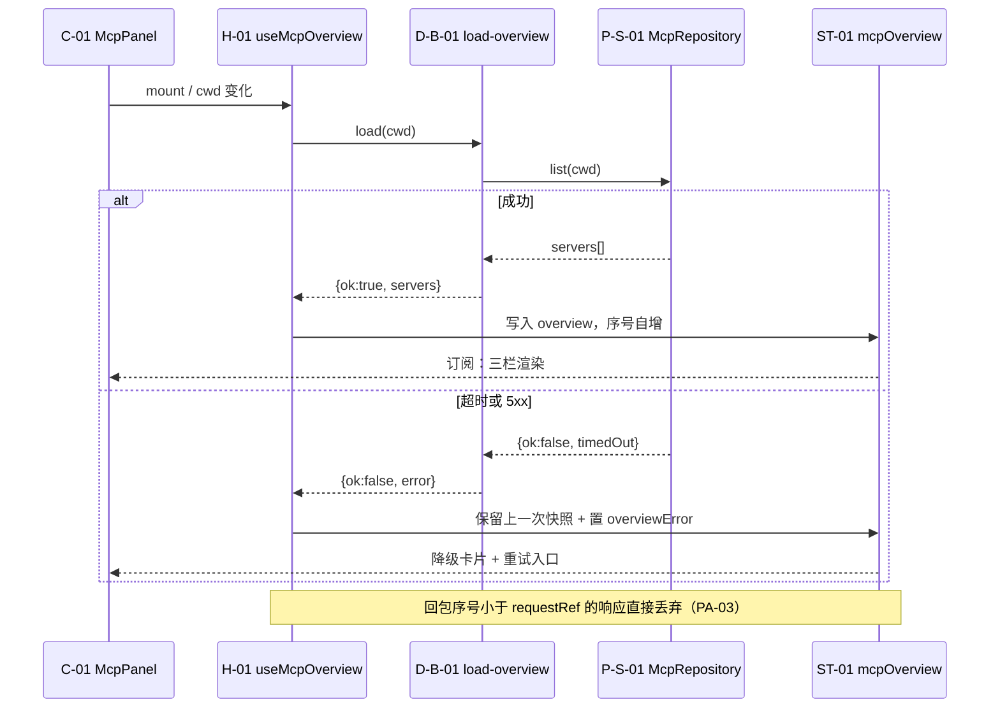
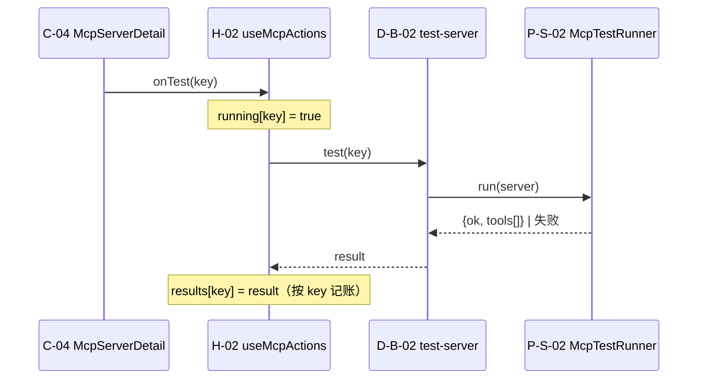
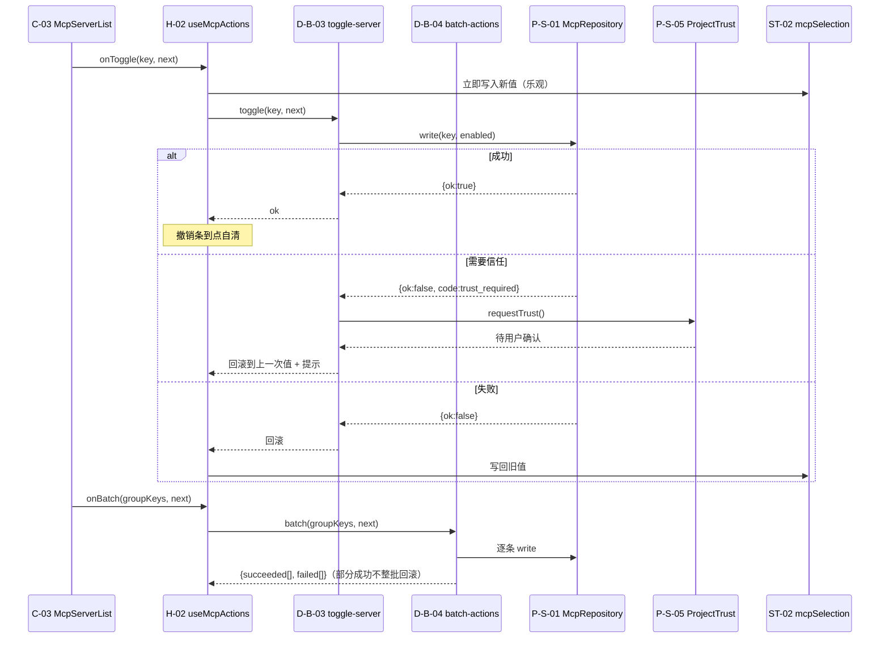
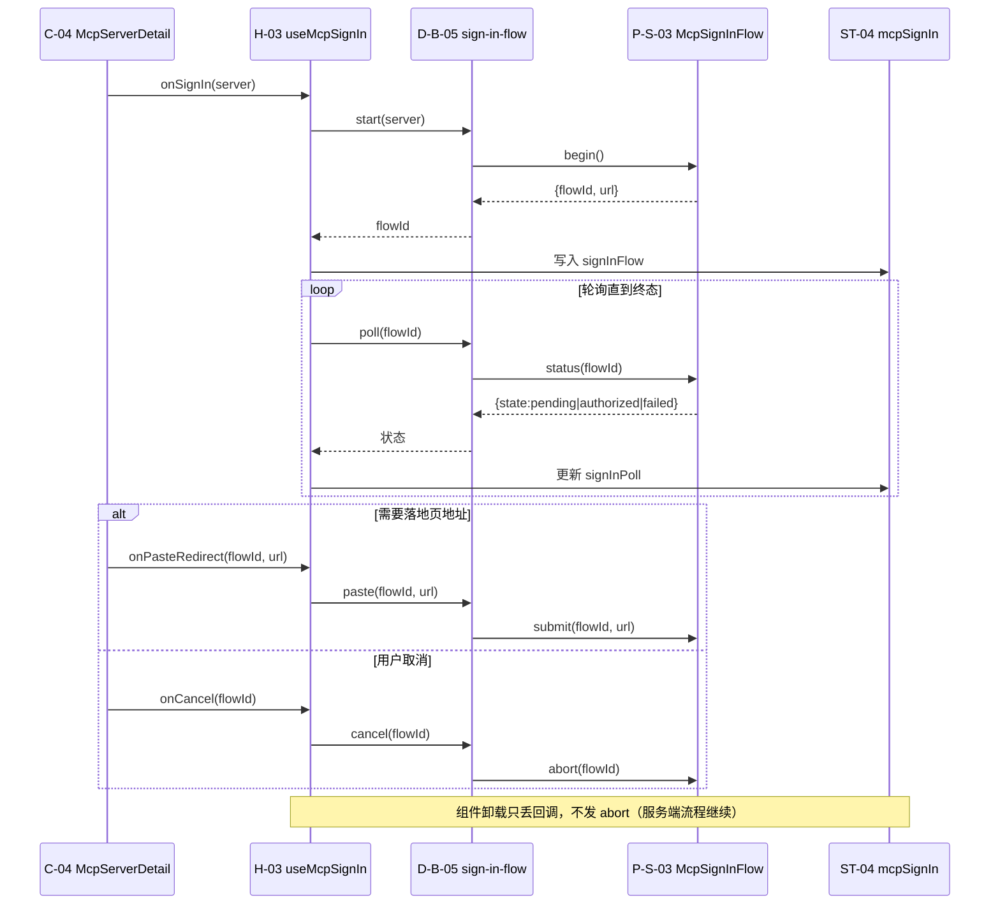
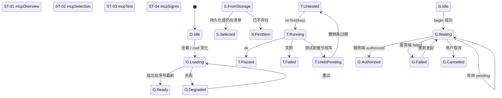

# 动态视图 — C-G / `McpConfig.tsx`

> 静态图回答"谁依赖谁"，这里回答"一次交互里谁先谁后、失败走哪条路"。
> 校验：`design-gate.mjs --run .evo/migration/20261022-C-G-mcp --design-only`（D13 图节点必须是已声明 id；D17 每个端口必须在序列图里出现、每个 store 必须有状态图）

## 1. 加载与降级

## 2. 单条测试（按 key 去重）

与 §3 同构（H-02 → D-B-02 → P-S-02 → 写回 ST-03），差别只有"按 key 记账、可并行"和"卸载只丢回调不 abort"。

## 3. 启用/停用与批量（乐观写 + 逐条记账）

## 4. 签到（服务端持有流程，客户端轮询）

## 6. 状态图（4 个 store 合成一张）

> 合成而非一 store 一图：分开画时一半是 `[*] --> Idle` 样板；读图的人真正要比对的是
> "同一时刻哪些 store 在等、谁负责推进"（如 Loading 与 Running 互不阻塞）。

## 7. 失败与取消：谁负责收尾

| 场景 | 谁收尾 | 具体做什么 |
|---|---|---|
| 加载失败 | H-01 | 保留旧快照 + 置 `overviewError`，由 C-02 渲染重试 |
| 测试失败 | H-02 / ST-03 | 按 key 回填失败结果并从在飞集合移除，不冒泡 |
| 启用失败 | H-02 / ST-02 | 回滚到上一次值，撤销条状态一并清掉 |
| 批量部分失败 | D-B-04 | 逐条记账，失败的单独提示，成功的不回滚 |
| 签到失败 | H-03 / ST-04 | 保留 `flowId` 供重试；不自动取消服务端流程 |
| 卸载 | H-03 | 只清轮询回调，**不 abort** 服务端流程 |

## 8. 行为 ↔ 图对应

分组级映射（逐条对应见 `behaviors.md`，不在此重复）：加载/展示 → §1 + ST-01/ST-02；单条与批量动作 → §2、§3 + ST-03；签到 → §4 + ST-04；Code mode 本次不迁。
