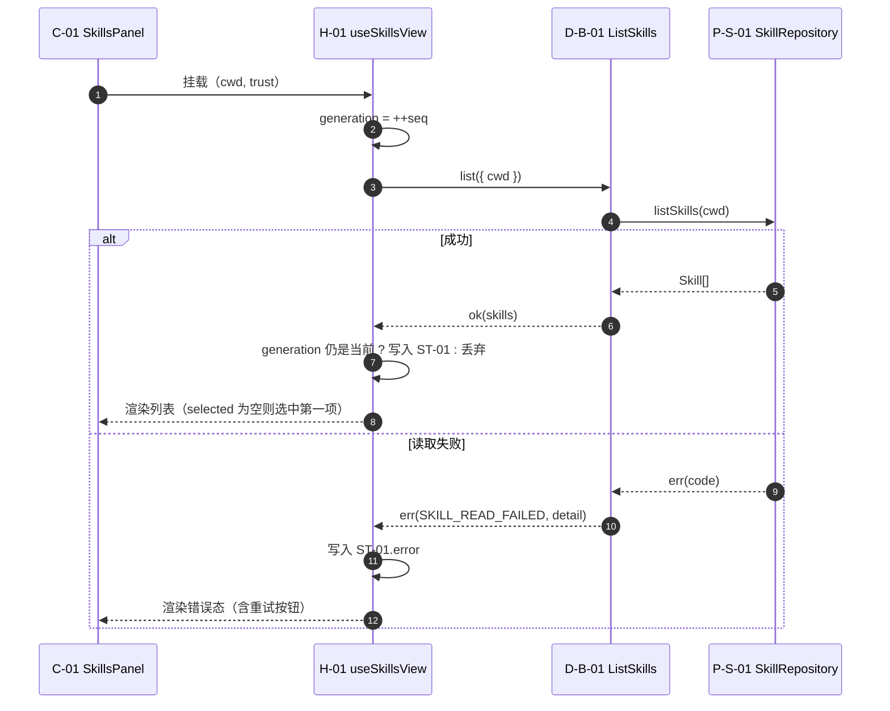
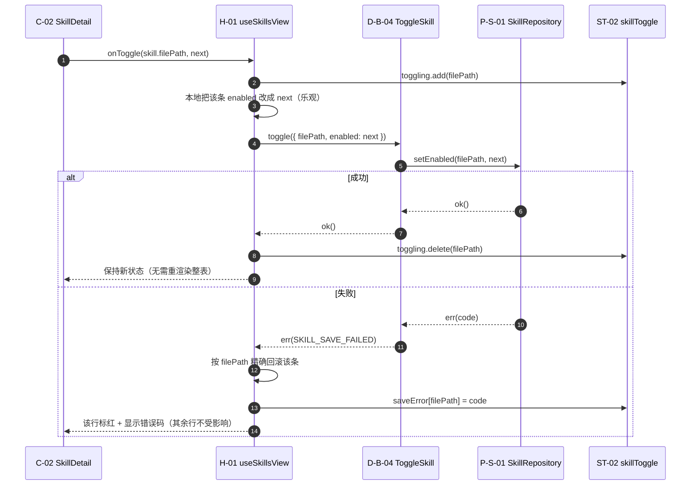
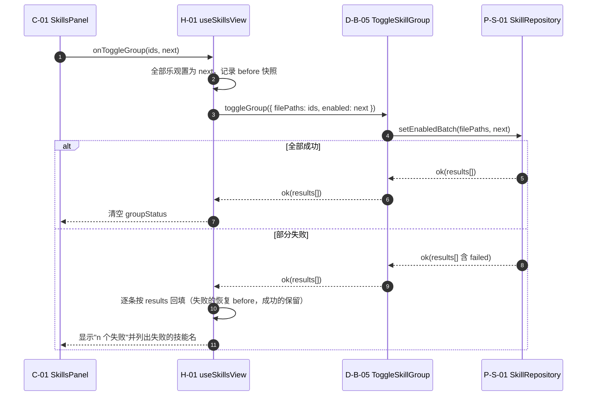
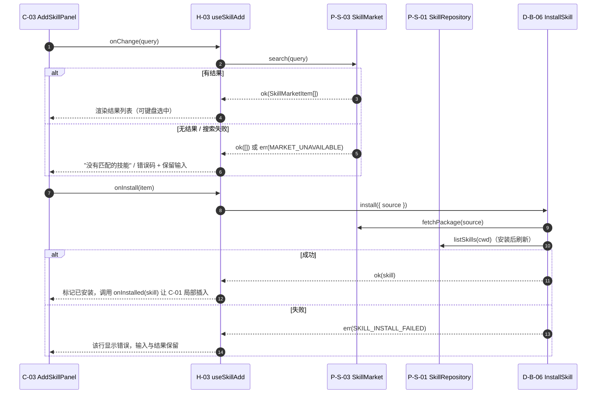
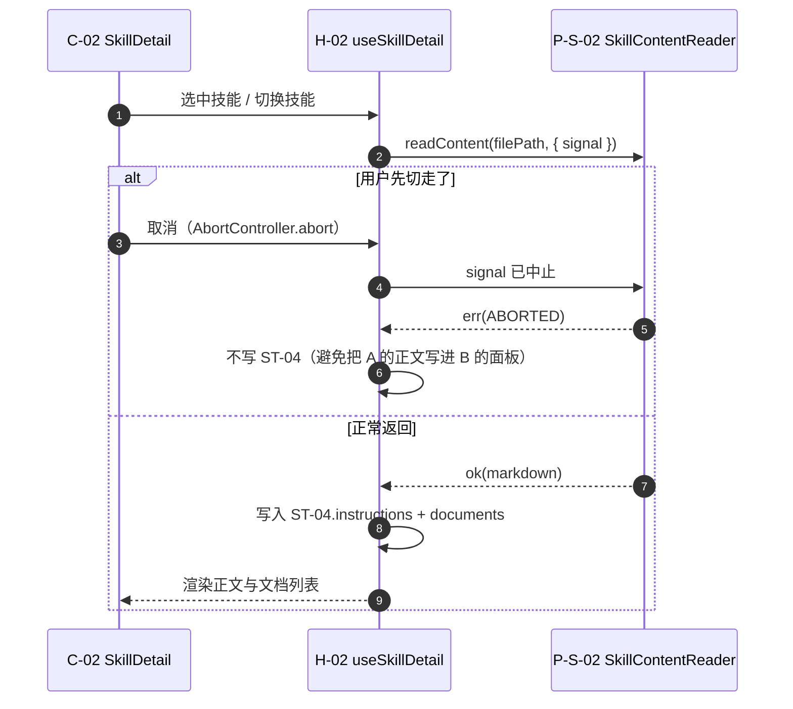
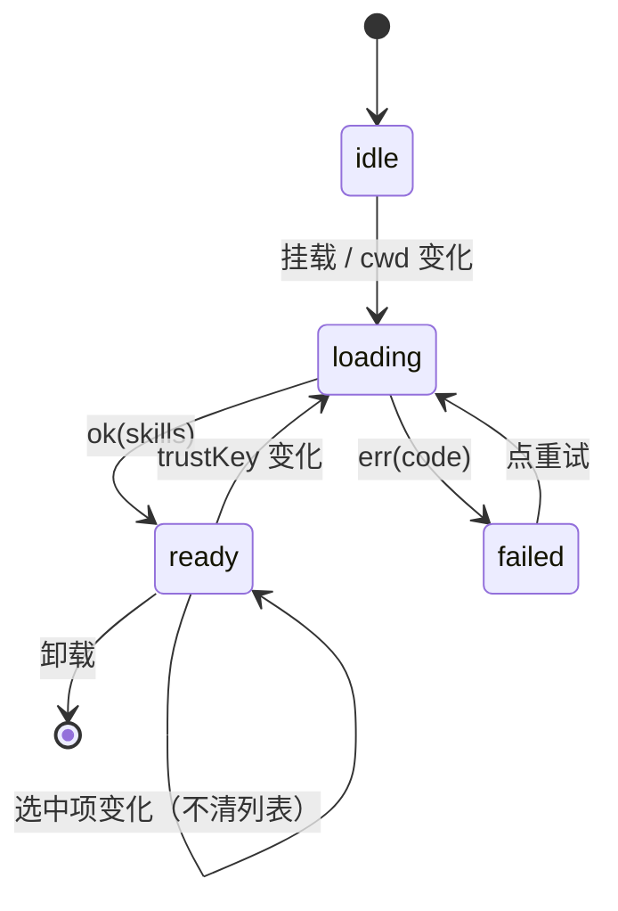
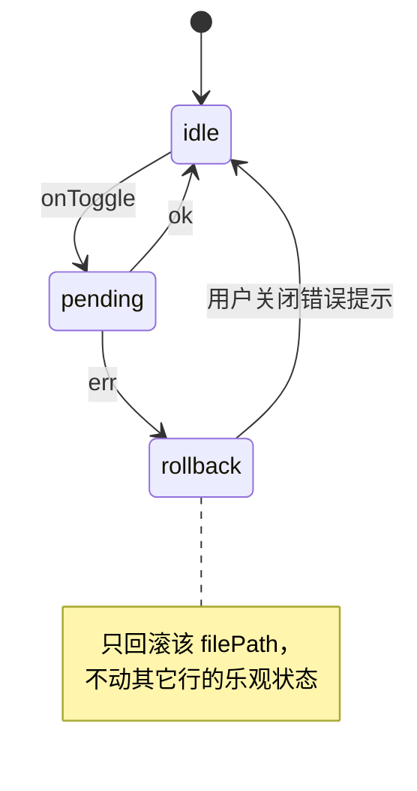
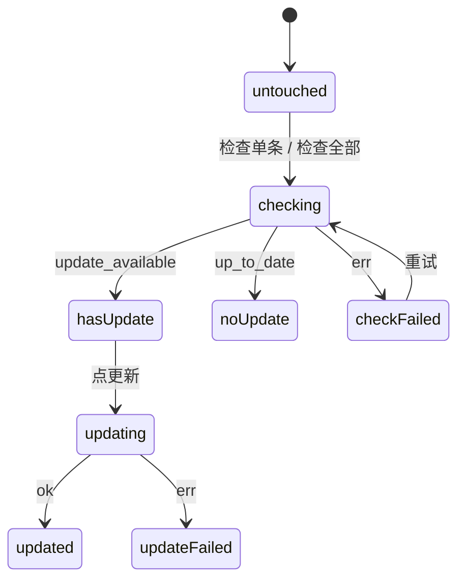
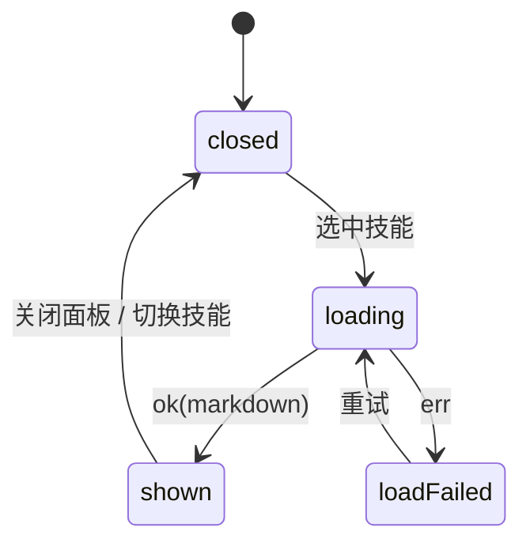
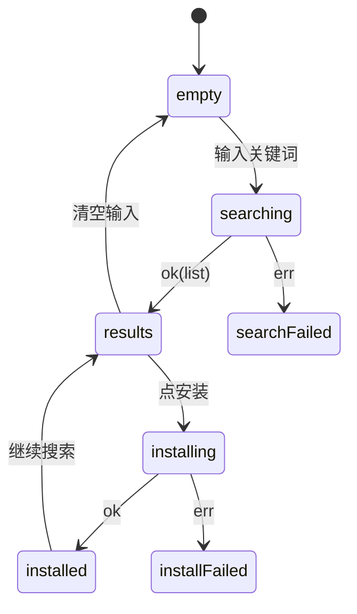

# 动态视图 — C-H「设置 · 技能」

> 静态图说"谁是谁"，这里说"**接口怎么被调用、状态怎么流转、失败怎么收尾**"。
> 给实施的人看：每张序列图就是一个要写的函数体骨架。
> 给测试的人看：`alt` 分支就是用例清单——每条 `else` 至少一个测试。
> 机器判据：D13（节点 id 已声明）· **D17**（≥1 张 `sequenceDiagram` 且每个端口出现；每个 store 至少一张 `stateDiagram`）。

## 1. 首次加载（`B-001` / `B-002`）

**为什么带 `generation`**：`trustKey` 变化时源码会整体重载（`:692`）；用户连续切项目时旧请求可能后到，不丢弃就会把 A 项目的技能画进 B 项目。

## 2. 开关一个技能（`B-006`，乐观 + 回滚）

## 3. 批量开关（`B-007`）

## 3.5 市场搜索与安装（`B-011` / `B-012`）

## 4. 读详情原文（`B-008`，可取消）

## 5. 状态流（每个 store 一张）

### 5.1 `ST-01 skillsView`

### 5.2 `ST-02 skillToggle`

### 5.3 `ST-03 skillUpdates`

### 5.4 `ST-04 skillDetail`

### 5.5 `ST-05 skillAdd`

## 6. 失败与取消：谁负责收尾

| 场景 | 谁发起取消 | 谁负责回收 | 不回收的后果 |
|---|---|---|---|
| 切技能时详情还在加载 | `H-02`（`AbortController`） | `P-S-02` 收到 signal 中止，`H-02` 丢弃结果 | 旧正文盖住新技能 |
| `cwd` 变化时列表还在请求 | `H-01`（`generation` 递增） | `H-01` 比对 generation 丢弃 | A 项目技能画进 B 项目 |
| 卸载时开关请求未回 | 组件卸载 | `H-01` 的清理函数置 `mounted=false` | React 警告 + 状态错乱 |
| 批量部分失败 | 不取消 | `D-B-05` 返回 `results[]`，`H-01` 逐条回填 | 一半 UI 显示成功实际失败 |

## 7. 行为 ↔ 图对应

| 行为 | 图 |
|---|---|
| `B-001` 首次加载 / `B-002` trustKey 重载 | §1、§5.1 |
| `B-004` 加载失败与重试 | §1 `else` 分支、§5.1 |
| `B-006` 单开关 | §2、§5.2 |
| `B-007` 批量开关 | §3 |
| `B-008` 读详情原文 | §4、§5.4 |
| `B-011`/`B-012` 搜索与安装 | §5.5 |
| `B-013`/`B-014`/`B-015` 检查与更新 | §5.3 |
