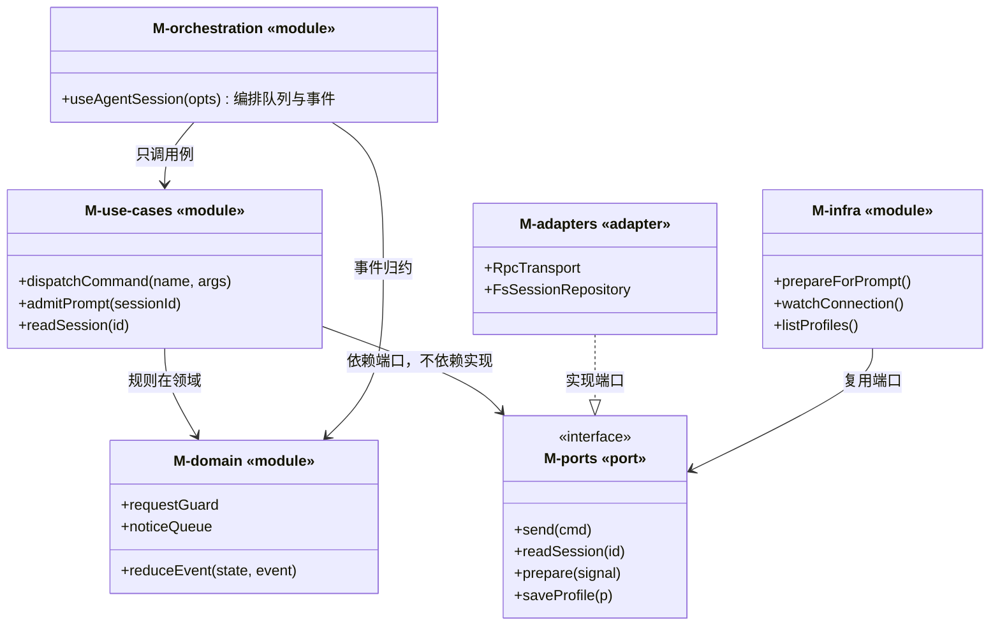

# 静态视图（基础设施形态）：模块与端口

> 本能力没有组件树（不渲染界面），等价物是**模块图 + 端口**。
> 判据 D11/D17：模块上图并标型、依赖边成 DAG、每个模块说清"不负责什么"。

读法三条：`-->` 是编译期依赖（向下/向内）；`..|>` 是实现关系（适配器实现端口）；**没有一条箭头从 M04 指出**——端口不知道谁实现它。

## 模块清单

| 模块 | 型 | 落点 | 负责什么 | 不负责什么 |
|---|---|---|---|---|
| M-orchestration | module | `packages/core/src/agent/orchestration` | 把命令、事件、队列装配成"一次会话" | 不做协议细节、不读文件 |
| M-use-cases | module | `packages/core/src/agent/use-cases` | 命令分发、串行准入、会话读 | 不碰 fetch/子进程 |
| M-domain | module | `packages/core/src/agent/domain` | 事件归约、乱序守卫、通知队列 | 不持 IO |
| M-ports | port | `packages/core/src/agent/domain/ports` | 声明 4 个边界能力 | 不含实现 |
| M-adapters | adapter | `packages/core/src/agent/adapters` | rpc 传输、fetch 实现 | 不含业务规则 |
| M-infra | module | `packages/core/src/agent/infrastructure` | MCP 生命周期、子代理档案读写 | 不决定 UI |

## 端口清单

| 端口 | 方法 | 实现者 | 被否方案 | 错判代价 |
|---|---|---|---|---|
| P-A-01 传输 | `send(cmd)` / `subscribe(handler)` | `RpcTransport` | 直接用 WebSocket，不给端口 | 换传输层要改用例 |
| P-A-02 会话读 | `readSession(id)` / `list(cwd)` | `FsSessionRepository` | 用例里直接 `readFileSync` | 无法在测试里造"读失败" |
| P-A-03 MCP 运行时 | `prepare(signal)` / `watch()` | C-G 的 `McpHost` 适配 | 本能力重写一份 MCP | 两套协议实现必然分叉 |
| P-A-04 子代理档案 | `list/save/delete` | `FsProfileStore` | 直接读写 `~/.pi/agents` | 路径穿越与 scope 合并规则散落 |

## 关键取舍

| 取舍 | 症状 | 选了 | 被否方案 | 错判代价 |
|---|---|---|---|---|
| 事件归约放领域纯函数 | `hooks/useAgentSession.ts:1430` 一个 300 行 switch | 抽成 `reduceEvent(state, event)` 纯函数 | 留在 hook 里改 state | 无法单测竞态，只能靠 e2e |
| 准入放用例层 | `lib/rpc-manager.ts:691` 准入与分发耦合在一起 | `admitPrompt` 单独用例 | 塞进 dispatchCommand | 分叉/克隆时容易绕过准入 |
| 流式数据放 ref | `hooks/useAgentSession.ts:364` | 领域只产出增量事件，渲染层自己决定 | 领域里缓存整段文本 | 长回答内存翻倍 |

## 不适用（区域 → 入口清单）

本能力是**基础设施**：7,669 行的 agent 运行时没有任何一屏界面，它的"入口"是 RPC 命令与事件通道，不是按钮。
入口清单在这里没有语义——真要列，只能把 `wire.md` 的 67 条命令抄一遍，那是契约不是界面。证据：`ref_projects/pi-web/hooks/useAgentSession.ts:1463`（命令分发入口，返回 `Promise<unknown>`，不返回 JSX）。

## 前端最佳实践（模块级）

基础设施没有组件，但同样有"必须做到"的工程实践，逐条给落点：

| 实践 | 落在哪 | 做到什么程度 |
| --- | --- | --- |
| 错误语义封闭 | `packages/core/src/agent/domain/agent-types.ts` | 错误码是闭集 `invalid-request/not-found/transport-failed`，不抛异常，一律 `Outcome` |
| 幂等 | `packages/core/src/agent/use-cases/send-command.ts` | 同 `clientRequestId` 2 秒内只发一次（双击/重试共用同一个键） |
| 取消与收尾 | `packages/core/src/agent/use-cases/abort-turn.ts` | 取消后必须收到 `aborted` 事件才算收尾，不等超时 |
| 背压 | `packages/core/src/agent/use-cases/notice-queue.ts` | 通知队列有上限（保留最近 200 条），超限丢最旧并计数 |
| 竞态 | `packages/core/src/agent/use-cases/reduce-event.ts` | 只应用 `requestId` 更大的事件（`useAgentSession.ts:387` 的语义），过期直接丢 |
| 资源释放 | `packages/core/src/agent/adapters/sse-transport.ts` | 退订即关流，`AbortController` 与订阅一一对应 |
| 可观测 | `packages/core/src/agent/use-cases/reduce-event.ts` | 每次丢弃都留一次计数与原因，别静默 |
| 重试 | `packages/core/src/agent/adapters/http-transport.ts` | 只对 5xx/网络错误重试 2 次，4xx 不重试 |
