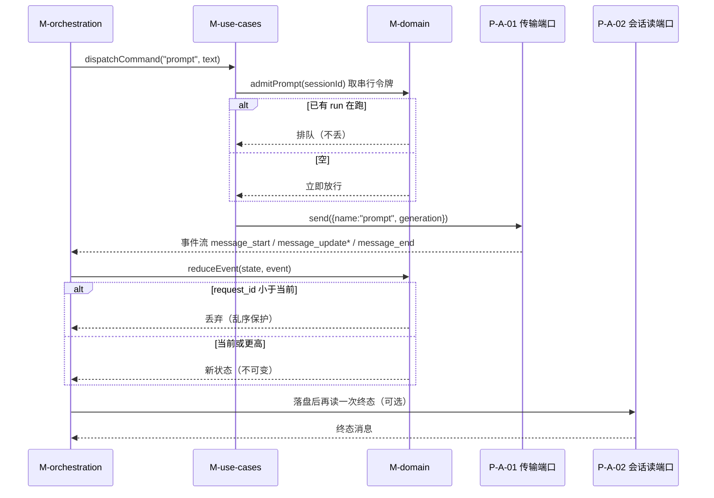
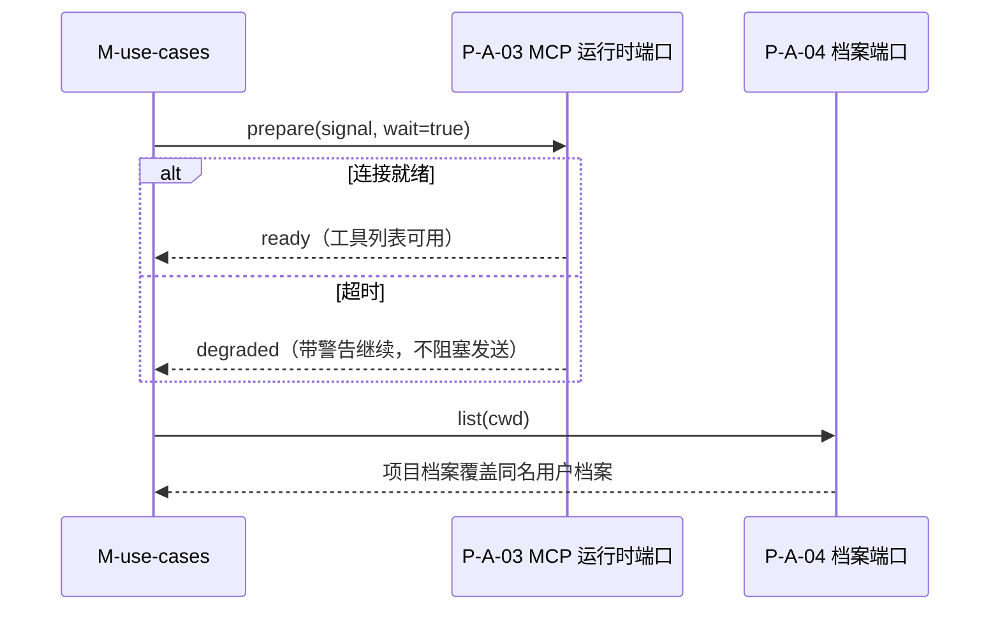
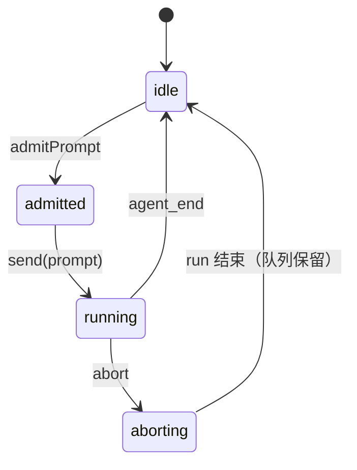
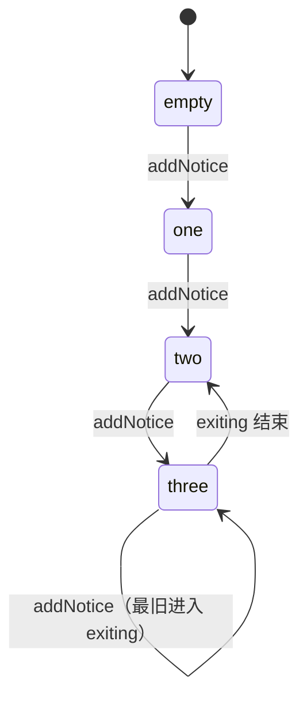

# 动态视图：命令链路 / 事件归约 / MCP 准备

## 1. 一条 prompt 的完整链路

## 2. MCP 准备链路（prompt 前）

## 3. 准入状态机

## 4. 通知队列状态机

## 5. 失败与取消：谁负责收尾

| 情形 | 谁收尾 | 收尾动作 | 不许发生 |
|---|---|---|---|
| prompt 失败 | M-use-cases | 归还准入令牌、通知入队 | 令牌不归还导致会话卡死 |
| 传输断开 | M-infra | 标记 closed、通知重连、拒绝新调用 | 静默重试把旧请求再发一次 |
| 用户取消 | M-orchestration | abort → 等 run 结束 → 归还令牌 | 直接丢 Promise 导致状态永挂 |
| 会话切换 | M-use-cases | 旧 generation 作废 | 旧回包写入新会话 |

## 6. 行为 ↔ 图对应

| 行为 | 落在哪张图 |
|---|---|
| B-001 / B-015…B-024 | 图 1（命令链路与事件归约） |
| B-028…B-032 | 图 3（准入与乱序守卫） |
| B-033…B-038 | 图 2（MCP 准备） |
| B-025 / B-026 | 图 4（通知队列） |
