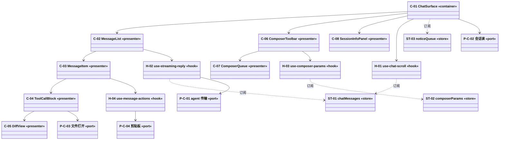

# 组件与模块视图 — C-C 会话面

## 1. 静态视图（mermaid）

读法三条：`-->` 是调用依赖（向上只能是 presenter → hook → port）；`..>` 是订阅（store 只被 hook/容器订阅，不进 props 链）；**没有任何箭头从 port 指出**——端口不知道自己被谁用。

## 2. 元素清单

| id | 型 | 落点 | 负责什么 | 不负责什么 |
|---|---|---|---|---|
| C-01 | container | `packages/web/src/features/chat/chat-surface.tsx` | 取数、滚动、通知入队、把回调下发给 presenter | 不渲染消息内部结构 |
| C-02 | presenter | `message-list.tsx` | 列表顺序与虚拟滚动边界 | 不持有消息状态 |
| C-03 | presenter | `user-message.tsx` / `assistant-message.tsx` | 气泡、时间戳、复制/编辑入口 | 不调 agent、不解析 patch |
| C-04 | presenter | `tool-call-block.tsx` | 工具状态、参数摘要、时长 | 不做 diff 解析 |
| C-05 | presenter | `diff/split-diff.tsx` | 两栏 diff 渲染 | 不读文件内容 |
| C-06 | presenter | `composer-toolbar.tsx` | 主行（附件/发送 或 引导/追加）+ 更多控件面板 | 不决定参数语义（那是 H-03） |
| C-07 | presenter | `composer-queue.tsx` | 排队行展示（引导/追加 两种色）+ 撤回入口 | 不持有队列状态（ST-02） |
| C-08 | presenter | `session-info-panel.tsx` | 会话信息面板（模型/统计/路径） | 不取数、不改会话 |

## 3. hook 职责

| id | 签名 | 替换源码 | 被谁用 | 职责 |
|---|---|---|---|---|
| H-01 | `useChatScroll(containerRef, deps)` | `ChatWindow.tsx:512-633` | C-01 | 贴底判定、位置恢复、搜索定位 |
| H-02 | `useStreamingReply(store, onCommit)` | `ChatWindow.tsx:1521-1541` | C-02 | 流式增量订阅与提交时机 |
| H-03 | `useComposerParams(agent)` | `ChatWindow.tsx:701-1100` | C-06 | 12 个控件的值与动作 |
| H-04 | `useMessageActions(deps)` | `MessageView.tsx:410-419` | C-03 | 复制/编辑/分叉 |

## 4. store 职责

| id | state | 订阅者 | 生命周期 |
|---|---|---|---|
| ST-01 | `messages`、`streamingBlocks` | C-02、H-02 | 会话切换时整体替换 |
| ST-02 | `model`、`thinkingLevel`、`toolPreset` | C-06、H-03 | 会话内持久，切会话重读 |
| ST-03 | `notices`、`paused` | C-01 | 页面级，随壳存活 |

## 4.5 区域 → 入口清单

原型（`ui.md`）里画了什么，这里就得有什么；反过来也一样。少画、多画都判红。

| 区域 | 入口 | 源 |
|---|---|---|
| 顶栏左侧 | 信任项目 | `ref_projects/pi-web/components/AppShell.tsx:1500` |
| 顶栏左侧 | 完整历史 | `ref_projects/pi-web/components/AppShell.tsx:1555` |
| 顶栏左侧 | 生成标题 | `ref_projects/pi-web/components/AppShell.tsx:1624` |
| 顶栏左侧 | 分支 | `ref_projects/pi-web/components/AppShell.tsx:1753` |
| 顶栏左侧 | 系统 | `ref_projects/pi-web/components/AppShell.tsx:1770` |
| 顶栏左侧 | 工具 | `ref_projects/pi-web/components/AppShell.tsx:1807` |
| 顶栏右侧 | 会话信息 | `ref_projects/pi-web/components/AppShell.tsx:1860` |
| 顶栏右侧 | 文件面板 | `packages/web/src/shell/layout/top-bar.tsx:96` |
| 队列 | ▲ 引导 | `ref_projects/pi-web/components/ChatInput.tsx:2316` |
| 队列 | ▼ 追加 | `ref_projects/pi-web/components/ChatInput.tsx:2357` |
| 表单 | 模型▾ | `ref_projects/pi-web/components/ChatInput.tsx:2471` |
| 状态 | 重试 | `ref_projects/pi-web/components/ChatWindow.tsx:1006` |
| 状态 | 重试这一条 | `ref_projects/pi-web/components/MessageView.tsx:1180` |

说明：顶栏 7 个入口的宿主是 **C-B**（见 `CHARTER.md` 的「渲染边界」），本能力原型里画它们是为了对齐位置关系，实施时由壳提供。

## 5. 前端最佳实践

| 实践 | 落在哪 | 做到什么程度 |
|---|---|---|
| 容器展示分离 | C-01 | 容器只做取数与回调，presenter 不 import 任何 port（`check-boundaries` 判据在壳侧同规则） |
| 状态就近 | ST-01 | 消息与流式块只由容器层 store 持有，presenter 通过 props 收到，不自建 useState |
| 派生状态不落库 | C-02 | "最终回答"下标每次由 D-B-04 纯函数派生，不存进 store |
| 渲染优化 | C-02 | 列表按 `entryId+blockIndex` memo，流式块独立节点，避免整树重渲染 |
| 列表 key 稳定 | C-02 | key 用 `entryId + blockIndex`，禁止数组下标（编辑后位移会串台） |
| 受控一致 | C-06 | 12 个控件全部受控于 ST-02，单向 onChange，无内部镜像 state |
| 可访问性 | C-01 | 消息区 `role="log"` + `aria-live="polite"`，运行态播报由容器发出 |
| 错误边界 | C-03 | 每条消息外包 ErrorBoundary，catch 到异常只渲染该条的错误态 |
| 三态 | C-01 | 首屏骨架 / 空态引导 / 错误重试三态由 manifest.triStates 定义并有测 |
| 并发竞态 | H-02 | 按 requestId 单调比较，过期的增量直接 ignore 丢弃（迁自 `ChatWindow.tsx:387`） |
| 缓存与失效 | H-02 | 会话切换即清空 store（invalidate 全部），过期数据不做 revalidate |
| 代码分割 | C-05 | diff 渲染按需 `dynamic import`，首屏不加载解析器 |

## 6. 关键取舍

| 症状 | 选了什么 | 被否方案 | 错判成本 |
|---|---|---|---|
| 流式每 delta 重建整棵树 | 独立 StreamingReply 订阅 store | 全量重渲染 | 长会话不可用 |
| 并行工具结果串台 | 按 `toolCallId` 绑定 | 按出现顺序配对 | 用户看到错误归属 |
| diff 解析失败消息空白 | 降级纯文本保留原文 | 抛错 | 用户看不到改动 |

## 7. 变化出处

- `D-U-05` → `ChatWindow.tsx:250-700`（ownership 同源）
- `D-U-13` → `MessageView.tsx:1151-1344`
- `D-B-05`（派生）→ `derivedFrom: D-U-15`，理由见 manifest
