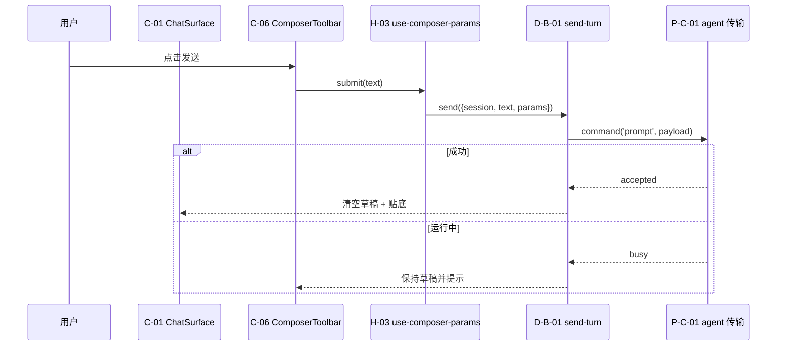
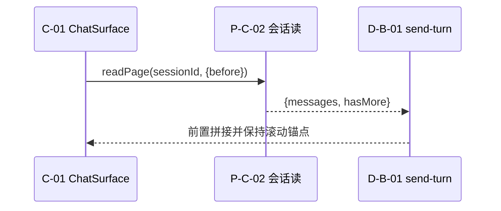
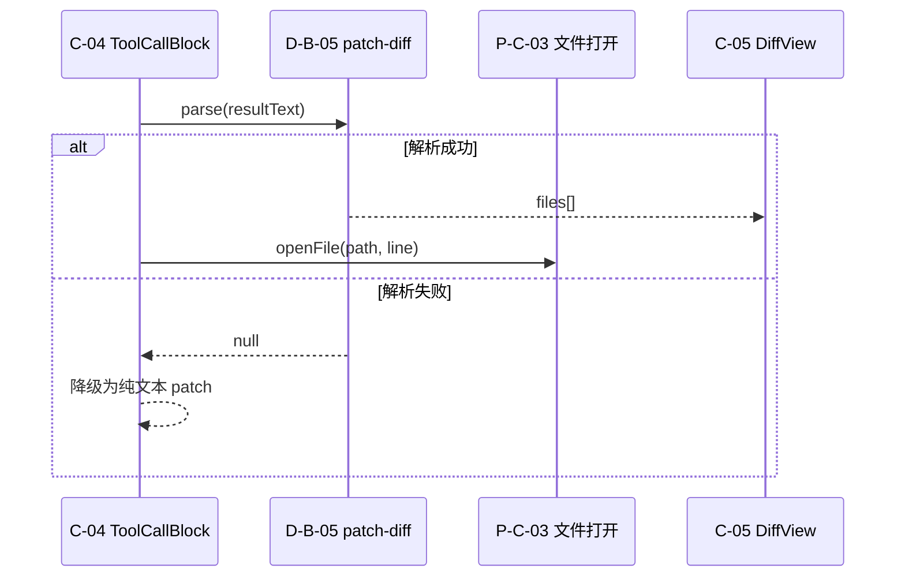
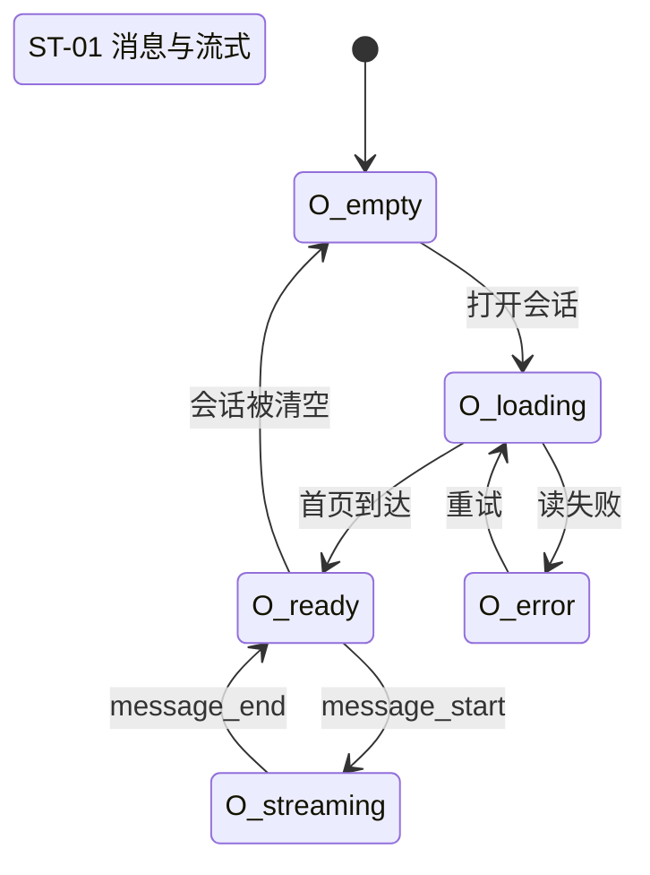

# 动态视图 — C-C 会话面

## 1. 主链路：发送一轮消息

## 2. 读历史页

## 3. 工具结果与 diff

## 4. 消息 store 状态机

## 5. 失败与取消：谁负责收尾

| 场景 | 谁收尾 | 收尾动作 |
|---|---|---|
| 发送失败 | D-B-01 | 保留草稿、运行态回落、通知入队 |
| 中断 | D-B-02 | 标"已中止"而非"失败"，已产出消息保留 |
| 读历史失败 | C-01 | 保留已加载内容，底部提供重试 |
| 流式乱序 | H-02 | 按 requestId 丢弃过期增量 |
| diff 解析失败 | C-04 | 降级纯文本，不显示空白 |

## 6. 行为对应

B-001…B-006 → 第 1、2 节；B-009…B-024 → 第 4 节；B-028…B-031 → 第 3 节；B-045 → 第 1 节末。
