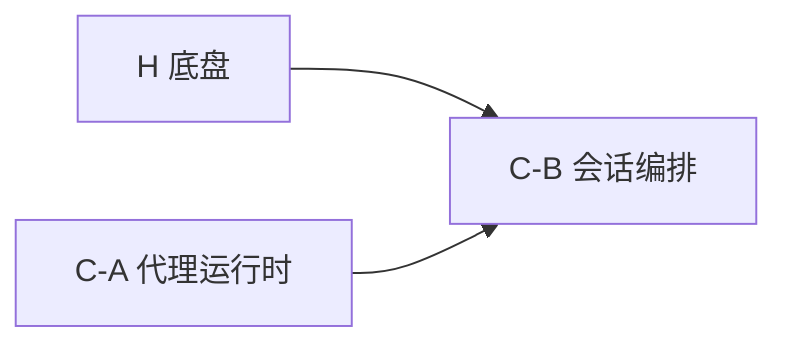

<!-- TODO-init-scaffold（由 state.mjs init 从 references/templates/CAPABILITIES.md 铺底）
     1. 逐节把占位符换成真实内容（不要留 <...>）
     2. 填完后删掉这段注释——留着的 TODO 就是没做完
-->

# 能力切片模板 — `<program-run>/CAPABILITIES.md`

> P3 门（`capabilityPlan`）会解析本文件的表格：
> 每个 god 必须**恰好出现一次**（不漏不重）；每行必须带 R 级。

# 能力切片

## 1. 能力清单

> god 列用反引号写文件名——脚本靠它做归属核对。

| # | 能力 | 包含 god | R 级 | 依赖能力 | 状态 |
|---|---|---|---|---|---|
| C-A | 代理运行时 | `useAgentSession.ts` `rpc-manager.ts` | R3 | — | 待开始 |
| C-B | 会话编排 | `AppShell.tsx` | R3 | C-A | 待开始 |
| H | 底盘 | （无 god，来自壳的布局部分） | R3 | — | 待开始 |

状态取值：`待开始` / `进行中` / `已完成` / `已移交`。

## 2. 拓扑序

依赖无环；割接依赖全部能力。

## 3. 裁线

| 里程碑 | 能力 | 说明 |
|---|---|---|
| M1 | C-A → H → C-B | 能当日常工具用的最小集合 |
| M2 | 其余 | 割接前补齐 |

## 4. 每能力的验收物（PM 视角）

| 能力 | 用户能看到什么 | 怎么验 |
|---|---|---|
| C-A | 发送消息有流式返回 | 打开会话 → 发送 → 看到增量 |
| C-B | 点会话行切换、URL 同步 | 点三次不同会话 + 刷新 |
