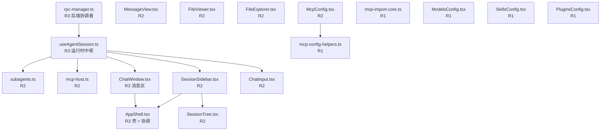

# god 文件全景 — pi-web → evo-pi 迁移

> **作用**：仓库里**哪些文件是 god、谁依赖谁、风险多高、迁到哪、什么状态**的唯一权威清单。
> **校验**：本文件的「清单封闭」与「R 级」由 P0 门机器核验（`node .pi/skills/migrating-god-files/scripts/check-phase.mjs --run <program-run> --phase P0`）。
> **权威性**：行数与 sha1 的**权威来源是 `<program-run>/state.json`**（由 `state.mjs init` 从磁盘钉取）。
> 本文件的行数字段只用于分诊，不作为证据——历史上曾因手抄行数产生误导。

## 0. 范围界定（哪些算 god）

| 判据 | 阈值 |
|---|---|
| 行数 | **> 1000 行** |
| 形态 | 组件 / hook / lib 模块 / class |
| 位置 | **仅 `ref_projects/pi-web/` 生产代码** |

### 明确排除

| 范围 | 原因 |
|---|---|
| `ref_projects/pi-web/demo/**` | 演示副本，非生产代码 |
| `ref_projects/pi-web/**/i18n/**` | 语言包（允许超长，不受文件上限约束） |
| `ref_projects/pi-web/node_modules/**`、`.next/**`、`dist/**` | 依赖与构建产物 |
| `*.test.ts(x)` / `*.spec.ts(x)` | 测试 |

### 归并登记（>1000 行但不单独立项）

| 文件 | 行数 | 处理 |
|---|---|---|
| `components/mcp-config-helpers.ts` | 1515 | **随 C-G（MCP）一起迁**，不单独作为一个交付单元 |

> 归并不是"不算 god"：它仍必须登记在本清单里（清单封闭），只是交付时并入所属能力，
> 避免把一个辅助模块单独立项造成流程开销。

## 1. god 清单（18 个，封闭）

| # | god | 路径 | 行数 | 角色 | 依赖 god | R 级 | 归属能力 | 状态 |
|---|---|---|---|---|---|---|---|---|
| 1 | `useAgentSession.ts` | `hooks/useAgentSession.ts` | 2805 | **agent 运行时中枢**（事件源，~1300 声明） | `rpc-manager.ts` | **R3** | C-A 代理运行时 | 已完成 |
| 2 | `rpc-manager.ts` | `lib/rpc-manager.ts` | 2757 | **后端协调者**（`AgentSessionWrapper` + 命令分发） | — | **R3** | C-A 代理运行时 | 已完成 |
| 3 | `subagents.ts` | `lib/subagents.ts` | 1002 | 子代理运行时 | `useAgentSession.ts` | R2 | C-A 代理运行时 | 已完成 |
| 4 | `mcp-host.ts` | `lib/mcp-host.ts` | 1105 | MCP Host 运行时 | `useAgentSession.ts` | R2 | C-A 代理运行时 | 已完成 |
| 5 | `AppShell.tsx` | `components/AppShell.tsx` | 2796 | **壳 + 协调者**（上行回调、失效广播、跨域原子重置、URL 同步） | `SessionSidebar.tsx`、`useAgentSession.ts`、`ChatWindow.tsx` | **R3** | C-B 会话编排（布局部分 → H 底盘） | 已完成 |
| 6 | `ChatWindow.tsx` | `components/ChatWindow.tsx` | 2282 | 消息区 + 扩展 UI 宿主 | `useAgentSession.ts` | **R3** | C-C 会话面 | 已完成 |
| 7 | `MessageView.tsx` | `components/MessageView.tsx` | 2161 | 消息渲染 | — | R2 | C-C 会话面 | 已完成 |
| 8 | `ChatInput.tsx` | `components/ChatInput.tsx` | 2869 | 输入区（草稿、引用、@提及、斜杠命令） | `useAgentSession.ts` | R2 | C-D 输入区 | 已完成 |
| 9 | `SessionSidebar.tsx` | `components/SessionSidebar.tsx` | 3165 | 侧边栏（会话库 + 项目分组 + 文件浏览 + 菜单） | `useAgentSession.ts` | R2 | C-E 会话库 | 已完成 |
| 10 | `SessionTree.tsx` | `components/SessionTree.tsx` | 1131 | 会话树 | `SessionSidebar.tsx` | R2 | C-E 会话库 | 待开始 |
| 11 | `FileViewer.tsx` | `components/FileViewer.tsx` | 1897 | 文件预览 | — | R2 | C-F 文件 | 待开始 |
| 12 | `FileExplorer.tsx` | `components/FileExplorer.tsx` | 1409 | 文件浏览 | — | R2 | C-F 文件 | 待开始 |
| 13 | `McpConfig.tsx` | `components/McpConfig.tsx` | 2258 | MCP 设置 | `mcp-config-helpers.ts` | R2 | C-G MCP | 已完成 |
| 14 | `mcp-config-helpers.ts` | `components/mcp-config-helpers.ts` | 1515 | MCP 配置辅助（归并登记） | — | R1 | C-G MCP（随迁） | 待开始 |
| 15 | `mcp-import-core.ts` | `lib/mcp-import-core.ts` | 1229 | MCP 配置导入（3 种格式解析） | — | R1 | C-G MCP | 待开始 |
| 16 | `ModelsConfig.tsx` | `components/ModelsConfig.tsx` | 2313 | 模型设置 | — | R1 | C-H 设置 | 待开始 |
| 17 | `SkillsConfig.tsx` | `components/SkillsConfig.tsx` | 1089 | 技能设置 | — | R1 | C-H 设置 | 待开始 |
| 18 | `PluginsConfig.tsx` | `components/PluginsConfig.tsx` | 1087 | 插件设置 | — | R1 | C-H 设置 | 待开始 |

**合计 18 个 god · 32,533 行**（生产代码，不含 demo 副本与 i18n 语言包）。

> 状态取值：`待开始` / `进行中` / `已完成` / `已移交`。
> 修改本表时：新增 god 必须登记（P0 门会扫盘核对），删除必须销号，R 级变动必须重跑 P3 切片。

## 2. 风险分级（R 级 → 门强度）

| R 级 | 判据 | god | 门强度 |
|---|---|---|---|
| **R3 中枢** | 跨域状态编排 / 协议中枢 / 壳协调 | 1、2、5、6 | 全 8 阶段 + 决策表 + 时序图 + 双重签字 + 渲染预算 |
| **R2 复杂界面+数据** | 多区数据 + 交互密集 | 3、4、7、8、9、10、11、12、13 | C1–C6，免序图，设计需批注 |
| **R1 独立模块/设置** | 单一职责 / 设置页 | 14、15、16、17、18 | C0/C1/C3/C5/C6/C7，免设计签字、免决策表 |

## 3. 依赖图（迁移顺序约束）

**推论**：`useAgentSession` + `rpc-manager` 是全局依赖源，必须先迁（C-A）；否则下游能力只能对着半成品写桩。

## 4. 能力切片（交付单元，P3 输出）

| 能力 | 包含 god | 行数 | R 级 | 依赖能力 | M1/M2 |
|---|---|---|---|---|---|
| **H 底盘** | （无 god；来自 `AppShell.tsx` 的布局/面板/主题/路由部分） | ~1,400 | R3 | — | M1 |
| **C-A 代理运行时** | `useAgentSession.ts`、`rpc-manager.ts`、`subagents.ts`、`mcp-host.ts` | 7,669 | R3 | — | M1 |
| **C-B 会话编排** | `AppShell.tsx`（排除底盘部分） | ~1,400 | R3 | C-A、H | M1 |
| **C-C 会话面** | `ChatWindow.tsx`、`MessageView.tsx` | 4,443 | R3/R2 | C-A、H | M1 |
| **C-D 输入区** | `ChatInput.tsx` | 2,869 | R2 | C-A、C-C | M1 |
| **C-E 会话库** | `SessionSidebar.tsx`、`SessionTree.tsx` | 4,296 | R2 | C-A、H | M1 |
| **C-F 文件** | `FileViewer.tsx`、`FileExplorer.tsx` | 3,306 | R2 | H | M2 |
| **C-G MCP** | `McpConfig.tsx`、`mcp-config-helpers.ts`、`mcp-import-core.ts` | 5,002 | R2/R1 | C-A、H | M2 |
| **C-H 设置** | `ModelsConfig.tsx`、`SkillsConfig.tsx`、`PluginsConfig.tsx` | 4,489 | R1 | H | M2 |

**M1 拓扑序**：`H0` → `C-A` → `C-B` → `C-E` → `C-C` → `C-D`
**M2**：`C-F` → `C-G` → `C-H`

> 能力切片的正式产物是 `<program-run>/CAPABILITIES.md`（P3 生成并签字）。本表是**输入建议**，
> 以 `CAPABILITIES.md` 为准；P3 门会核对「每个 god 恰好归入一个能力」。

## 5. 交付状态总览

| 项 | 值 |
|---|---|
| god 总数 | 18 |
| 已交付 | 0 |
| 进行中 | 0 |
| 里程碑 | M1 未开始 / M2 未开始 / 割接未开始 |
| 纲领 run | 待建档（`state.mjs init --scope program`） |

## 6. 与旧清单的差异（可追溯）

| 变更 | 原因 |
|---|---|
| 新增 `FileExplorer.tsx`（1409）、`PluginsConfig.tsx`（1087） | 旧清单漏登；P0 的 `godRegistryClosed` 扫盘核对发现 |
| `mcp-config-helpers.ts` 由「排除」改为「归并登记」 | 排除会让清单不封闭；归并登记既保持封闭又不增加交付单元 |
| 行数按磁盘重算 | 旧清单存在手抄误差（如 AppShell 2797 vs 实际 2796） |
| 新增 `R 级` 列 | 门强度按风险裁剪，避免低风险模块被高流程成本拖住 |
| 新增 `归属能力` 列 | 交付单元是能力而不是文件；god 只作为对账轴 |
| 删除旧的两个 run 目录引用 | 旧目录是流程试验的临时产物，已废弃 |
