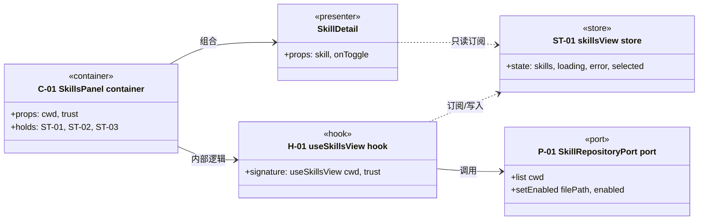

# 组件与依赖 — `<capability>/design/components.md`

> 这是**静态视图**：谁由谁组成、谁是容器谁是展示、状态归哪个 store、谁订阅它。
> 机器判据：D11（组件树闭合）、D12（hook/store 归属）、D13（图里 id 已声明）、**D17**（每个组件标 `«container»`/`«presenter»`、hook 标 `«hook»`、store 标 `«store»`，依赖用 `-->`、订阅用 `..>`）。
> 写法要求：**先画图，再用表解释**。图和表对不上时，以图为准去改表。
> 图内 id 用 `C01` 这种短名（mermaid 的 classDiagram 不认连字符），**真实 id 写在标签里**——`class C01["C-01 SkillsPanel «container»"]`。

## 1. 静态视图（UML 组件图 / 类图）

**读法（三句话，写给开发和测试）**

1. 实线 `-->` = 依赖（调用/组合）；虚线 `..>` = 订阅（读 store，不直接改）。
2. `«container»` 持有状态与用例调用；`«presenter»` 只收 props，不认端口。
3. 测试落点：容器层组件测「状态流转 + 端口调用」，展示组件测「给定 props 的渲染与交互」，域函数用纯单测。

## 2. 元素清单（与 `manifest.json` 的 `components[] / hooks[] / stores[]` 一一对应）

| ID | 名称 | 型 | 落点 | 负责什么 | 不负责什么 |
|---|---|---|---|---|---|
| `C-01` | `<Panel>` | container | `packages/web/src/...` | 列表、选中、更新状态 | 详情渲染、市场搜索 |
| `C-02` | `<Detail>` | presenter | `packages/web/src/...` | 给定 skill 渲染正文 | 发起请求 |

## 3. hook（组件内部业务逻辑）

| ID | 职责（一句话，≥10 字） | 签名 | 替换源码 | 被谁使用 | 里面有什么（调用哪些端口） |
|---|---|---|---|---|---|
| `H-01` | 把列表、选中、动作串起来，并处理竞态 | `useX(input: {...}): XView` | `<god>#Lx-Ly` | `C-01` | `P-xx.list` / `P-xx.setEnabled` |

> hook 不是"再抽一层"，它必须能指回旧代码（`replaces` 必填）。没有对应旧代码的 hook 就是多造抽象。

## 3.5 前端最佳实践（这节是给实施的人看的，也是给测试的人排期用的）

每条实践必须落到**已声明的元素**，并写清"做到什么程度"。写成"注意性能"等于没写——实施时没人知道该加 `memo` 还是该拆组件。机器判据：**D18**（≥6 类，落点必须是已声明 id，措辞 ≥10 字且带机制词）。

| 实践 | 落在哪 | 做到什么程度 |
|---|---|---|
| 容器展示分离 | `C-01` / `C-02` | |
| 状态就近 | `C-02` | |
| 派生状态不落库 | `H-01` | |
| 渲染优化 | `C-02` | 用什么机制（memo / useMemo / 虚拟列表） |
| 列表 key 稳定 | `C-02` | |
| 受控与非受控一致 | `C-02` | |
| 可访问性 | `C-03` | role / aria / 键盘路径各写一句 |
| 错误边界 | `C-01` | |
| 三态齐备 | `C-01` | loading / 空 / 错误各一条分支 |
| 代码分割 | `C-03` | |
| 并发竞态 | `H-01` | 取消或 generation 丢弃 |
| 缓存与失效 | `ST-01` | |

## 4. store（内部状态 + 订阅关系）

| ID | 职责（一句话，≥10 字） | state | 持有者 | 谁订阅（只读） | 生命周期 |
|---|---|---|---|---|---|
| `ST-01` | 本能力的可写状态唯一落点 | `skills` `loading` `error` | `C-01` | `C-02` | 挂载到卸载；`cwd` 变化重置 |

## 5. 关键取舍

| 症状 | 选了什么 | 被否方案 | 错判成本 |
|---|---|---|---|
| `<god>#Lx` 或 `B-00x` | | | |

## 6. 变化出处

改造中新出现的组件/hook/store 怎么指回源码：`<god>#Lx-Ly`（直接行段）、"合并说明"、或 `rationale + derivedFrom`（派生元素，D14 核对）。
