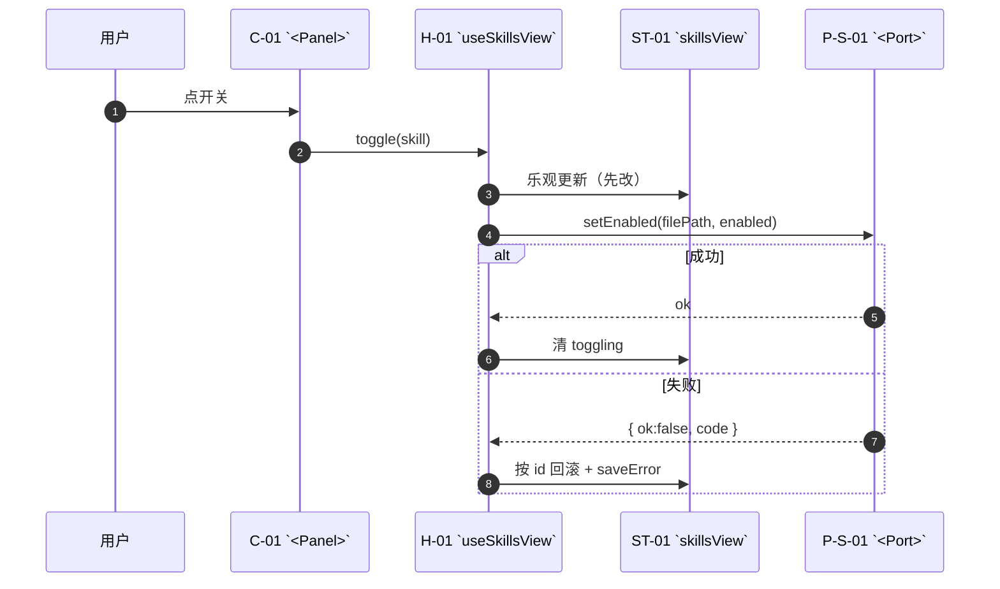
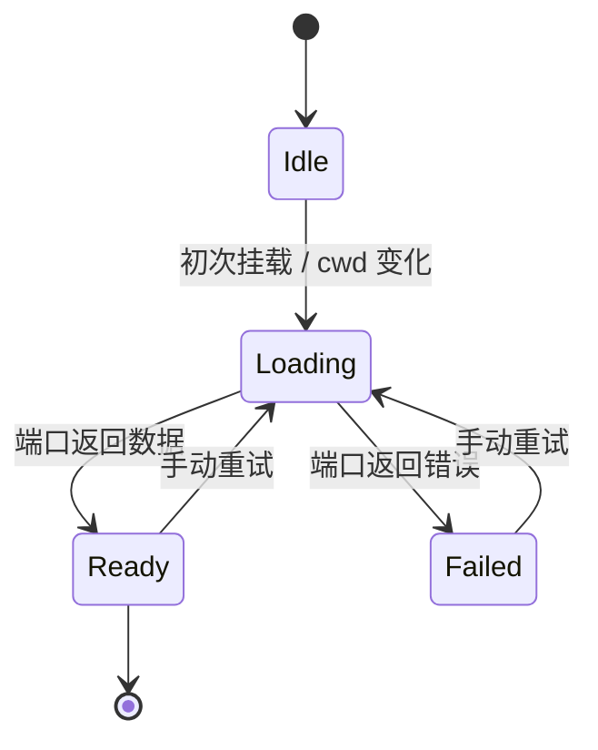

# 动态视图 — `<capability>/design/dynamics.md`

> **接口不是被陈列的，是被调用的。** 这份文件回答三个问题：一次用户动作经过谁、状态怎么变、失败怎么回滚。
> 机器判据：D13（节点 id 已声明）、**D17**（至少一张 `sequenceDiagram`，且每个端口都出现过；每个 store 至少一张 `stateDiagram`）。

## 1. 主链路（sequenceDiagram）

## 2. 状态流（每个 store 一张 stateDiagram）

## 3. 失败与取消（写清"谁负责收尾"）

| 场景 | 谁取消 | 过期响应怎么处理 | 用户看到什么 |
|---|---|---|---|
| 快速切换详情 | 发起方（`AbortController` + 递增计数） | 丢弃过期响应，不写入 store | 只有最后一次的正文 |
| 开关失败 | 不取消（乐观更新已生效） | 按 id 回滚 | 行内错误 + 保持旧值 |
| 安装进行中关面板 | 不取消（服务端会装完） | 完成后回调容器层 | 面板已关，列表里出现新技能 |

## 4. 时序与行为的对应

| 行为 ID | 对应序列图/状态图 |
|---|---|
| `B-001` | `§1` 主链路 |
