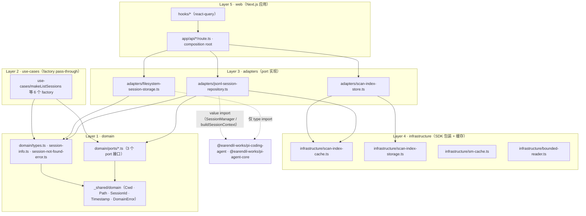

# Clean Architecture 四层落地

`packages/core` 采用 capability-first 的四层结构（domain / use-cases / adapters / infrastructure），并在其中夹一层 `domain/ports/`（Hexagonal 的 ports-in-domain 变体）。`packages/web` 是 Uncle Bob 意义上最外层的应用层。

规则文本有两处权威来源：

- **ADR 0003** 定 macro 架构：有哪些包、跨 capability 怎么通信、`domain` 不依赖任何其他包。
- **Architecture 0001** 定 micro 架构：每个 `core/src/<capability>/` 的精确目录结构、import 允许/禁止清单、命名约定、verification checklist。

## 依赖方向



箭头方向就是依赖方向：越靠内的层被越多层知道，越外层的层对内一无所知。

## 逐层职责与真实文件

| Layer | 目录 | 拥有什么 | 本仓真实文件 |
|---|---|---|---|
| 5 · Web 应用 | `packages/web/src/{app,components,hooks}` | Route Handler、React 组件、取数 hook | `app/api/sessions/route.ts`、`hooks/useSessionContext.ts`、`components/app-shell/Layout.tsx` |
| 4 · Frameworks & Drivers | `core/src/<cap>/infrastructure/` | SDK 包装、纯数据结构、测试 fixture | `scan-index-cache.ts`（LRU + 内存压力淘汰）、`scan-index-storage.ts`（落盘）、`sm-cache.ts`（SessionManager 缓存）、`bounded-reader.ts`（有界文件读取） |
| 3 · Interface Adapters | `core/src/<cap>/adapters/` | port 的具体实现，domain ↔ SDK 的翻译层 | `jsonl-session-repository.ts`、`filesystem-session-storage.ts`、`scan-index-store.ts`、`in-memory-session-repository.ts`（测试 fake） |
| 2 · Use Cases | `core/src/<cap>/use-cases/` | 应用业务规则，编排 entity + port | `list-sessions.ts`、`read-session-context.ts`、`read-session-entries.ts`、`read-session-info.ts`、`read-session-tree.ts`、`search-sessions.ts`（均为 factory 函数） |
| 1b · Ports | `core/src/<cap>/domain/ports/` | 抽象输入/输出契约 | `session-repository.ts`、`session-storage.ts`、`session-indexer.ts` |
| 1 · Entities | `core/src/<cap>/domain/` | value object、实体、领域错误 | `types.ts`、`session-info.ts`、`session-entry.ts`、`agent-message.ts`、`session-not-found-error.ts` |
| 跨 capability 共享 | `core/src/_shared/domain/` | branded 类型与错误基类 | `cwd.ts`、`path.ts`、`session-id.ts`、`timestamp.ts`、`domain-error.ts` |

跨 capability 通信按 ADR 0003 的三条规则走：共享类型走 `_shared/`、同 capability 内 use-case 可直接互调、跨 capability 逻辑走 port + adapter 反转。当前 `_shared/` 只被 `session` 与 `system` 两个 capability 使用（`Cwd` 是唯一跨 capability 共享的类型）。

## web 作为最外层：两条隔离机制

**1. 编译期隔离**：`packages/web/tsconfig.json` 的 `exclude` 里含 `"../core/**"`，web 不能直接读 core 的源码路径，只能通过 `@evo-pi/core` 的 `exports` 映射消费编译产物 `dist/`。core 的 exports 为每个 capability 提供根 barrel（`.`、`./session`、`./system`）与通配（`./session/*`）。

**2. 运行时隔离**：`packages/web/next.config.ts` 把 `@evo-pi/core` 与两个 SDK 包列入 `serverExternalPackages`，让 Node 在运行时解析它们而不被 Turbopack 打包——因为 SDK 传递依赖里有 `wasi_snapshot_preview1`、`env` 这类 Node 内建 require（来自 quickjs-wasi），打包会失败。

## 规范与实现的三处偏离

Architecture 0001 的规则文本与当前代码并不完全一致，以下三点以**代码为准**：

**偏离 1：web 直接使用 concrete adapter。** 规范把 `web/ → core/adapters/` 列为禁止，并要求在 `web/src/lib/adapters/` 建 web-specific adapter 实现 port（规范 checklist 第 4 条就是 grep 这个路径）。实际代码里 `web/src/lib/adapters/` 不存在；三个 Route Handler 从 `@evo-pi/core/session` barrel 直接 import `JsonlSessionRepository`、`FileSystemSessionStorage`、`ScanIndexStore`——而 session barrel 本身就 re-export 了这些具体实现类。因此规范里那条 grep 检查会通过（路径不是 `adapters/`），但实质上 web 依赖的是具体实现而不是 port 接口。这实际是 composition root 模式（依赖注入发生在最外层），是六边形架构的合法变体，但与 Architecture 0001 的文字规定冲突。

**偏离 2：domain 层编译期依赖 SDK。** 规范写 `domain/ → anything outside domain/` 禁止。实际 `session/domain/` 下的 `types.ts`、`session-info.ts`、`session-entry.ts`、`agent-message.ts`、`domain/ports/session-repository.ts`、`domain/ports/session-storage.ts` 都从 SDK 导入类型。好消息是这些**全部是 `import type` / `export type`**，不产生运行时依赖边；代价是 SDK 升级会直接冲击 domain 层的类型检查。这是刻意的取舍：代码注释记录了判断依据——`AgentMessage` 只存在于 `pi-agent-core` 而 SDK 高层包不 re-export，所以 core 同时依赖两个 SDK 包，并要求消费方统一从 `@evo-pi/core` 的 barrel 导入，避免直接碰 SDK 的包分割。

**偏离 3：infrastructure 里有未接线的模块。** `SmCache`（SessionManager LRU）与 `bounded-reader`（有界读取）在 `infrastructure/index.ts` 中导出，但除自身测试外**没有任何生产代码引用**——真实读路径直接在 adapter 里调 SDK（`SessionManager.open` / `getEntries` / `getTree` / `buildSessionContext`）。它们是为后续性能优化预留的零件，不要误以为当前 list/search 走了缓存或分块读取。

另外，Architecture 0001 §Concrete Examples 里的目录树（`create-session.ts`、`append-message.ts`、`file-session-storage.ts`、`domain/session-context.ts` 等）描述的是**规划中的目标形态**，与当前已落地的读侧实现（`read-session-*.ts`、`filesystem-session-storage.ts`、`domain/types.ts`）并不一致。写侧用例尚未实现。

## 自查命令

Architecture 0001 给了 5 条 verification 检查，可直接用于审计任意 capability：

```bash
# 1. port interface 必须住在 domain/ports/，不能散落在别处
grep -rln "export interface.*Port\|export type.*Port" packages/core/src/<capability>/ --include="*.ts" | grep -v "domain/ports/"

# 2. use-cases/ 不得 import adapters/ 或 infrastructure/
grep -rln "from '.*/adapters/\|from '.*/infrastructure/" packages/core/src/<capability>/use-cases/

# 3. web 不得 import core 的具体实现
grep -rln "from '.*core/.*/adapters/\|from '.*core/.*/infrastructure/" packages/web/src/

# 4. 类型与风格
pnpm exec tsc -p packages/core/tsconfig.json --noEmit
pnpm exec biome check packages/core/src/<capability>/
```

第 2 条在 `session` capability 上目前有命中，但**全部落在测试代码里**：两个性能测试（`list-sessions-perf.test.ts`、`read-side-perf.test.ts`）与共用 helper `use-cases/__test-helpers__.ts` 需要构造真实 adapter 才能验证集成行为。生产 use-cases 文件本身是干净的。

## 相关页面

- [session capability](./session-capability.md) — 三个 port 的契约与 6 个 use-case 的实际行为
- [存储适配与 scan-index](./session-storage-and-scan-index.md) — Layer 3/4 的具体实现
- [系统全景](../overview/system-map.md) — 包与模块的依赖图
- [HTTP API 层](../web/api-routes.md) — web 作为 composition root 的接线
- [决策记录与交付纪律](../process/decision-records-and-delivery.md) — ADR 0003 / Architecture 0001 全文索引
