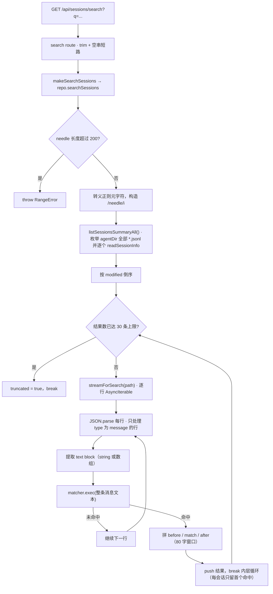

# session 搜索：ponytail 扫描算法、上限与截断语义

搜索是当前唯一"每次请求都全量读盘"的读侧路径：它不复用 scan-index、不设时间预算、不返回 `entryId`。理解这三件事，才能正确解释搜索的延迟表现与 UI 能做到什么。

## 端到端流程

## 算法细节

### 候选集：整个 agentDir，不限 cwd

候选来自私有 `listSessionsSummaryAll()`：枚举 `${agentDir}/sessions/` 下**所有** cwd 子目录的 `*.jsonl`，逐个 `readSessionInfo`。这是刻意的（搜索应跨项目），但也意味着搜索代价随磁盘上会话总数线性增长，且完全不经过 scan-index——方法上方的注释写着 "uses cache"，实现里没有任何缓存访问。

### 匹配规则

- 查询先 `trim()`，空串直接返回空结果（不抛错）。
- 长度 > 200 抛 `RangeError`（常量 `MAX_SEARCH_QUERY_LENGTH = 200`）。
- 正则元字符被转义，匹配大小写不敏感——所以搜索是**字面量包含**，不是全文检索。
- 只处理 `type === 'message'` 的行，且要求 `message.content` 存在。
- `content` 既可以是字符串，也可以是数组；数组里只取 `type === 'text'` 的块，块下标即 `blockIndex`。
- 多个 text 块用 `\n` 拼成一条整体文本后做匹配。

### 每个会话只保留首个命中

内层循环在 push 结果后立刻 `break`，因此一个 session 最多贡献一条结果。候选按 `modified` 倒序，所以列表里靠前的是最近活跃的会话。

### snippet 拼接

| 字段 | 规则 |
|---|---|
| `before` | 命中点前最多 80 字符；`start > 80` 时前置 `...`；折叠连续空白并去掉前导空格 |
| `match` | 命中文本本身，折叠连续空白 |
| `after` | 命中点后最多 80 字符，折叠空白并去掉尾随空格；后面还有内容时追加 `...` |

`blockIndex` 通过一个手写的 `blockOffset` 游标计算——它在 `blocks.find()` 的回调里累加偏移量（每块之间按 1 个换行符计），因此该回调**依赖求值顺序**，是这段代码里最脆弱的部分。

## 上限：注释声明 vs 代码实现

方法头部的注释列出了来自参考实现的 9 步算法与三个常量上限，但**只有一部分被实现**：

| 上限 | 注释中的值 | 代码实际 |
|---|---|---|
| 查询长度 | ≤ 200 | ✅ 实现（超限抛 `RangeError`） |
| 结果条数 | MAX_RESULTS = 30 | ✅ 实现（`results.length >= 30` 触发 `truncated`） |
| 扫描文件数 | MAX_FILES = 500 | ❌ 未实现，注释在循环末尾自认这一点 |
| 单行长度 | MAX_LINE_CHARS = 1MB | ❌ 未实现 |
| 时间预算 | TIME_BUDGET_MS = 3s | ❌ 未实现，`streamForSearch` 的 `signal` 参数在调用点被省略 |

因此 **`truncated` 的唯一含义是"结果数达到 30 上限"**，不能解读为"扫描被时间或文件数截断"。前端如果据此展示"结果已截断，请细化搜索"，在时间预算缺失的情况下是不准确的。

另外两处当前缺口：

- **无 `entryId`**：代码注释解释了原因——JSONL 行在此处只解析出 `message.content`，没有解析行的 `id` 字段（参考实现读了整行）。因此 wire 层的 `SessionSearchResult.entryId` 恒为 `undefined`，UI 只能按 session 粒度过滤，无法定位到具体消息。
- **会话级字段不参与匹配**：`name` / `firstMessage` / `allMessagesText` 属于 Phase 3+ 范围，当前只匹配消息正文。

## 取消能力只有签名没有实现

`SessionStoragePort.streamForSearch(filePath, signal?)` 支持传入 `AbortSignal`，`FileSystemSessionStorage` 的实现也把它交给了 `createReadStream`。但 `searchSessions` 调用时**没有传 signal**，所以当前没有任何超时或取消真正生效。要加时间预算，只需在 repository 调用点构造一个定时器触发的 `AbortController` 并透传即可——底层已经就绪。

## 传输层映射

`/api/sessions/search` route 做了三件事：

1. `q` 参数 trim，空串直接返回 `{ results: [], truncated: false }`（不触发扫描）。
2. 把 `SessionSearchResult.session` 里的 `Date` 转成 ISO 字符串——不做这一步 wire schema 校验会直接失败。
3. `RangeError` 且消息含 `200` 时映射为 400，其余异常映射为 500 并回传 `error.message`。

详见 [HTTP API 层](../web/api-routes.md)。

## 相关页面

- [session capability](./session-capability.md) — `searchSessions` 在 repository 中的位置与 listSessions 的对比
- [存储适配与 scan-index](./session-storage-and-scan-index.md) — `streamForSearch` 的实现与 `getSessionFileForId` 的代价
- [HTTP API 层](../web/api-routes.md) — 搜索 route 的参数与错误映射
- [Session 浏览 UI](../web/session-browsing-ui.md) — 搜索结果如何被用作列表过滤器
