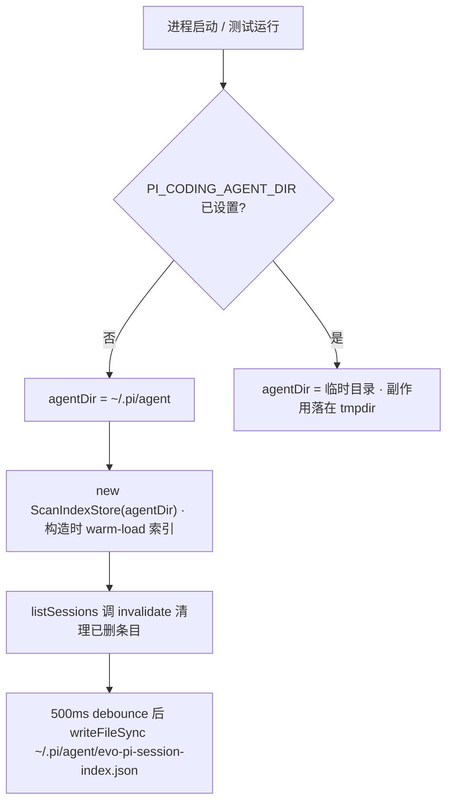

# 本地隔离纪律

这台机器上同时跑着两个应用：用户日常使用的 **pi-web（30141）** 和本仓库的 **evo-pi（30041）**。它们共享同一个会话数据目录 `~/.pi/agent`。因此本地操作有两条硬约束：**别碰 30141**、**别写 live 数据目录**。

## 端口约定

| 端口 | 归属 | agent 可以做什么 |
|---|---|---|
| 30141 | 用户的 pi-web | **只能用 `lsof -ti:30141` 查看是否在跑，禁止 kill** |
| 30041 | evo-pi dev server | 可以按端口 kill：`kill -TERM $(lsof -ti:30041)` |

`playwright.config.ts` 的 `baseURL` 默认值是 `http://localhost:30041`，由 `PLAYWRIGHT_BASE_URL` 覆盖——这与 `MEMORY.md` §6.1 的约定一致。

一个容易踩的细节：**e2e spec 内部还有第二层默认值**。三个 spec 各自写的是 `process.env.PLAYWRIGHT_BASE_URL ?? 'http://127.0.0.1:30041'`，并在自己的 `test()` 里用这个局部 `BASE_URL` 调 `page.goto`。也就是说 config 的 `baseURL` 与 spec 内的 `BASE_URL` 是两个独立来源，默认值一个用 `localhost` 一个用 `127.0.0.1`，设了 env 才会一致。

## 进程处理纪律

`MEMORY.md` §6.1 给出的可执行形式：

```bash
# 启动后台进程后立刻 capture PID
pnpm --filter @evo-pi/web dev & my_pid=$!

# 杀之前先确认是谁的进程
lsof -i:30041            # 或 ps aux | grep <pattern>

# 只用这两种方式杀
kill -TERM "$my_pid"                  # 自己启动的
kill -TERM $(lsof -ti:30041)         # 按端口
```

**明确禁止**：`pkill -f <pattern>`、`killall <name>`、`pgrep` + 循环 kill。这些会误杀 pi-web 或其他用户进程。

三条默认答案，任一答"不确定"就不 kill：

1. 是我的进程吗？→ 默认"不是"。
2. 必须 kill 吗？→ 默认"不需要"（验证通常只需 `curl`，dev server 可以留给用户自己管）。
3. 有更精确的方式吗？→ port > PID > 永不使用进程名匹配。

另外两条实用建议：**优先用 `pnpm -F <pkg> build` 而不是 `dev` 做验证**（无需常驻进程，也就没有"清理 dev"的问题）；**启动前先 `lsof -i:30041` 检查端口**，被占用就报告给用户而不是抢占。

## 数据目录：真实风险点

`PI_CODING_AGENT_DIR` 未设置时，`resolveAgentDir()` 解析到 `~/.pi/agent`（详见 [system capability](../core/system-capability.md)）。而 `ScanIndexStore` 的构造与失效都会碰这个目录：



也就是说，**任何在未覆盖 env 的进程里构造 `ScanIndexStore` 的代码都会写 live 目录**——包括导入 web Route Handler 的单元测试（route 在模块加载时就 `new ScanIndexStore(SYSTEM_CONFIG.agentDir)`）。这不是推测：`pnpm test` 跑完后 `~/.pi/agent/evo-pi-session-index.json` 的 mtime 会被刷新。

**规避方式**：在**启动进程之前**注入 env，指向一个临时目录。

```bash
PI_CODING_AGENT_DIR=$(mktemp -d) pnpm test
```

这同时修好了另一个现存问题——`/api/sessions/[id]/context` 的 5 个失败用例正是因此跑到了真实 agentDir 而不是 fixture（详见[单元与集成测试](../testing/unit-tests.md)）。注意 env 必须在 vitest **进程启动前**设置；在测试的 `beforeAll` 里设置已经太晚，因为 ESM import 会在测试钩子之前完成 route 模块求值。

## 正确的隔离范式

core 侧的性能测试与 fixture 测试给出了现成模板，可以直接照抄：

```ts
tmpDir = mkdtempSync(join(tmpdir(), 'perf-test-'))
const cwd = '/perf/test'
// 复刻 SDK 的 cwd → 目录名编码
const safePath = `--${cwd.replace(/^[/\\]/, '').replace(/[/\\:]/g, '-')}--`
sessionDir = join(tmpDir, 'sessions', safePath)
mkdirSync(sessionDir, { recursive: true })
```

三个要点：

1. **`mkdtempSync` 建独立 agentDir**，测试产物不落到 live 目录。
2. **目录名必须符合 SDK 的编码规则**（去掉开头的 `/`，把 `/ \ :` 换成 `-`，两侧加 `--`），否则 `SessionManager` 找不到文件，测试会以"会话不存在"的形式失败。
3. **JSONL fixture 手写 header 行**（`{"type":"session","version":3,...}`），保证与真实文件格式一致。

## ref_projects/ 是外部参考，不是实现依据

`ref_projects/` 下是若干完整 clone（`pi-web`、`pi`、`deepseek-harness`、`study`、`ui-ux-pro-max-skill` 等），被三处同时排除：

| 位置 | 规则 |
|---|---|
| `.gitignore` | `ref_projects/` |
| `biome.json` | `files.includes` 中的 `!**/ref_projects` |
| `.openwikiignore` | `ref_projects/` |

它不参与构建、不被 lint、不进 wiki。源码注释里大量出现的 `per ref_projects/pi-web/...` 只说明**设计意图的来源**，不构成 evo-pi 的实现证据——判断实际行为必须以 `packages/` 下的代码为准。这也是本 wiki 不引用该目录作为证据的原因。

## 相关页面

- [system capability](../core/system-capability.md) — `resolveAgentDir` 的解析顺序
- [存储适配与 scan-index](../core/session-storage-and-scan-index.md) — 索引写盘的触发时机
- [单元与集成测试](../testing/unit-tests.md) — env 覆盖为什么必须提前
- [端到端测试](../testing/e2e-playwright.md) — e2e 的端口前置条件
- [开发工作流](./developer-workflow.md) — 命令面与 CI
