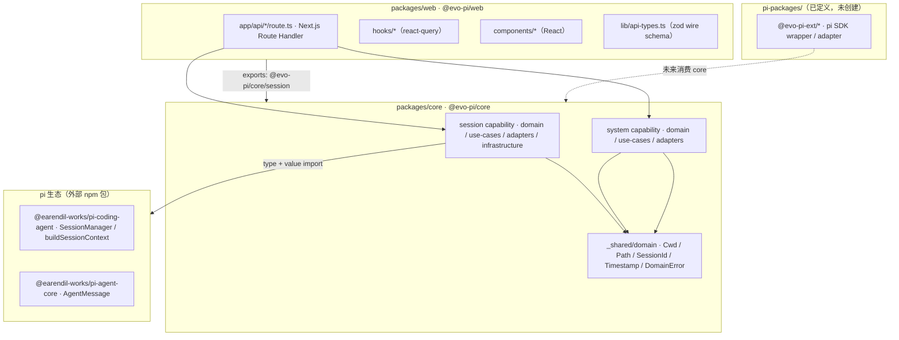

# 系统全景

evo-pi 是一个 **pi 生态之上的 workflow 引擎**，当前处于从参考项目迁移的读侧阶段：能列出本地 JSONL 会话、读取会话上下文、全文检索会话，并在浏览器里渲染。

## 仓库结构

```text
evo-pi/
├── packages/
│   ├── core/     @evo-pi/core     能力库（Clean Architecture 4 层）
│   └── web/      @evo-pi/web      Next.js 16 应用
├── pi-packages/  ← ADR 0002 已定义，但目录尚未创建
├── e2e/          Playwright 端到端用例
├── docs/         adr / architecture / agents / conventions
├── tooling/      预留的项目自维护脚本目录（当前仅 README）
├── MEMORY.md     跨会话项目记忆
└── AGENTS.md     AI agent 的导航与行为规则
```

## 双层 workspace 与一个空层

`pnpm-workspace.yaml` 声明两层 glob：

| 层 | glob | 命名空间 | 现状 |
|---|---|---|---|
| 核心自有 | `packages/*` | `@evo-pi/<name>` | `core`、`web` |
| pi 生态扩展 | `pi-packages/*` | `@evo-pi-ext/<name>` | **目录不存在** |

`pi-packages/` 目前只在配置与 ADR 里存在（ADR 0002 定义了它的定位：pi SDK 的 wrapper / adapter，`MEMORY.md` 开放问题 Q1 记为 deferred）。因此当前所有 pi 生态依赖都以普通 `dependencies` 形式直接声明在两个包里，没有经过 extension 包装层。

## 模块依赖图



依赖方向是单向的：`web → core → SDK`，core 不知道 web 的存在。web 侧 `tsconfig.json` 显式 `exclude` 了 `../core/**`，所以这条边只能通过 `@evo-pi/core` 的 `exports` 走编译产物。

## 两个包的职责分工

### `@evo-pi/core` — 能力库

已实现两个 capability：

- **session**：3 个端口 + 6 个读侧 use-case + JSONL/ScanIndex 适配器 + 索引基础设施。
- **system**：系统配置与项目信任的 2 个端口 + 内存 adapter。

对外入口是 `packages/core/src/index.ts`（re-export 两个 capability 的根 barrel）。

### `@evo-pi/web` — 应用

- `app/api/sessions*`：3 个 Route Handler，是 core 的 composition root。
- `hooks/`：3 个 react-query hook（列表 / 上下文 / 搜索）。
- `components/`：3 区布局外壳、sidebar 会话树、中心消息视图。
- `lib/`：zod wire schema、`fetchApi` 包装、zustand stores、i18n 注册表。

web **不直接读磁盘**，所有 IO 都经 core 的 use-case。

## 「pi 生态优先复用而非自研」如何落地

这是 `MEMORY.md` §1 列出的第一条核心约束（"pi 生态是依赖资产，能用 pi 就不自研"）。在代码里的体现：

| 位置 | 体现 |
|---|---|
| `packages/core/package.json` 的 `dependencies` | 只有两个 pi SDK 包，没有其他运行时依赖 |
| `FileSystemSessionStorage` | JSONL 解析、header/entry 读取全部交给 `SessionManager` |
| `JsonlSessionRepository.readSessionContext` | 上下文组装用 SDK 的 `buildSessionContext` 自由函数 |
| `JsonlSessionRepository.readSessionTree` | fork/subagent 树用 `SessionManager.getTree()` |
| `getSessionDir` | cwd → 目录名的编码规则直接复用 SDK，不自己实现 |
| domain 层类型 | 大量 `export type { ... } from '@earendil-works/...'` 直接跟随 SDK 升级 |

未被复用的部分因此非常显眼：自定义的只有 scan-index（指纹缓存）、有界读取、SDK 之上的编排逻辑，以及 web 侧的 wire 契约与 UI。这条边界是判断"某段代码该不该存在"的常用标准。

## 与文档的两处已知不一致

**1. `package.json` 的 description 落后于代码。** 两个包都还写着占位文案：

- `packages/core`：`"evo-pi core capability library (Clean Architecture 4-layer; per ADR 0003). Currently an empty scaffold pending first capability."`
- `packages/web`：`"evo-pi web app — Next.js 16 scaffold. Currently a placeholder pending first capability wiring."`

但 core 已实现 session + system 两个 capability 并接了真实 SDK 后端，web 也已完成端到端读侧链路。

**2. `MEMORY.md` §2 的状态表严重滞后。** 该表仍写"阶段：Phase 0 完成""capability 数 0（全部 placeholder）""单测数 56 vitest tests across 9 files"，而同一文件顶部的 "Phase 2 状态更新" 小节已声明 Phase 2 read-side 交付完成。实测 `pnpm test` 的真实结果是 **41 个测试文件、327 个用例，其中 5 个失败、1 个性能用例不稳定**。

**判断原则：以代码为准。** 本 wiki 的所有页面都以源码与实测输出为证据，文档中的状态描述只在被代码证实时才采信。

## 相关页面

- [Clean Architecture 四层落地](../core/clean-architecture-layers.md) — core 内部的分层与偏离
- [HTTP API 层](../web/api-routes.md) — web 与 core 的接线现场
- [开发工作流](../operations/developer-workflow.md) — workspace 与工具链配置
- [决策记录与交付纪律](../process/decision-records-and-delivery.md) — ADR 0002 全文与文档索引
