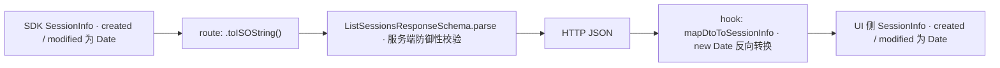

# HTTP API 层

当前 web 只有 3 个 Route Handler，全部是读接口，全部把 `@evo-pi/core` 的具体实现类在**模块加载时**接成单例。这里是应用的最外层，也是唯一知道"具体实现"的地方。

## 三个端点

| 端点 | use-case | 关键参数 | 特殊行为 |
|---|---|---|---|
| `GET /api/sessions` | `makeListSessions` | — | 先做 trust 检查（当前恒通过） |
| `GET /api/sessions/[id]/context` | `makeReadSessionContext` | `leafId`、`before`、`tail` | 响应体外层包一层 `{ context, tail, before }` |
| `GET /api/sessions/search` | `makeSearchSessions` | `q` | 结果里的 session 需 Date→ISO 转换 |

三者都导出 `dynamic = 'force-dynamic'`，所有响应（含错误响应）都带 `Cache-Control: no-store`——会话数据变化频繁，不允许 Next.js 层缓存。

## 每个 route 一套独立单例

三个文件各自重复了同一段接线：

```ts
const adapter = createInMemorySystemAdapter()
const getSystemConfig = makeGetSystemConfig({ config: adapter })
const SYSTEM_CONFIG = getSystemConfig()
const storage = new FileSystemSessionStorage(SYSTEM_CONFIG.agentDir)
const indexer = new ScanIndexStore(SYSTEM_CONFIG.agentDir)
const repo = new JsonlSessionRepository(storage, indexer)
```

由此产生一个不明显但重要的后果：**同一进程内有 3 份独立的内存 scan-index**（每个 route 各一个 `ScanIndexStore`），只有落盘的 `evo-pi-session-index.json` 是共享的。因此 `/api/sessions` 里 `invalidate` 掉的条目不会影响 `/api/sessions/search`，反之亦然；缓存命中率也按端点分别计算。

另一个后果是 `SYSTEM_CONFIG.agentDir` 在**模块加载时就被冻结**，运行期改 env 不生效——这正是 context route 测试失败的原因，见[单元与集成测试](../testing/unit-tests.md)。

代码注释给出了"模块级接线而非每请求实例化"的理由：use-case 依赖端口，接线一次更干净，也避免每请求重建索引。

## 日期的双向映射

JSON 无法表达 `Date`，而 core 返回的 `SessionInfo` 里 `created` / `modified` 是 `Date` 对象。映射在两个边界各做一次：



两端都做 zod 校验，但目的不同：

- **服务端 `parse` 是防御性的**——保证发出的响应一定符合已声明的 wire 契约。search route 的注释明确记录了这一点：不做 Date→ISO 转换，`SessionSearchResponseSchema.parse` 会直接抛错并变成 500。
- **客户端 `parse` 是边界校验**——ADR 0004 规定任何外部数据进入 domain 前必须 parse。`useSessionList` parse 之后调用 `mapDtoToSessionInfo` 把日期转回 `Date`，因此组件层拿到的仍是 SDK 形状，可以直接传给接受 `SessionInfo` 的组件。

## wire schema

`SessionInfoDto` 的 11 个字段与 SDK `SessionInfo` 一一对应，只有日期类型不同（`created` / `modified` 为 ISO 字符串）。列表响应额外带三个字段：

| 字段 | 当前值 |
|---|---|
| `sessionListVersion` | 恒为 `0` |
| `runningSessionIds` | 恒为 `[]` |
| `completionNotificationSuppressedSessionIds` | 恒为 `[]` |

后两个对应参考实现返回的 agent 运行态信息，evo-pi 尚未接线，但为保持 wire 兼容已在 schema 与响应中保留。

`AgentMessageSchema` 是 `UserMessageSchema | AssistantMessageSchema | z.record(z.unknown())` 的联合，最后一臂用于容忍 toolResult / custom / bashExecution 等尚未建模的角色。注释给了一条实现约束：**宽松分支必须放在联合的最后**，否则 `safeParse` 时会抢先匹配。

`SessionContextSchema` 的 `messages` 与 `entryIds` 是平行数组，但 schema **不校验**这个不变量——注释说明该不变量由 route handler / core 保证。

## 参数处理

### context：`tail` / `before` / `leafId`

```ts
const rawTail = Number(url.searchParams.get('tail'))
if (Number.isFinite(rawTail) && rawTail > 0) {
  if (rawTail > HARD_TAIL_CAP) return 400
  tail = Math.min(rawTail, HARD_TAIL_CAP)
}
```

- `HARD_TAIL_CAP = 10000`，与 core 的硬上限一致。
- **不传 `tail` 就不传给 core**，让 core 的默认 10000 生效。route 注释记录了这次调整的原因：默认 50 时真实会话（1351 条 message）只能看到 3.7%。
- `Number(null)` 是 `NaN`，所以缺省参数自然落到"不设置"分支，不需要额外判空。
- `leafId` 与 `before` 用 `?? undefined` 直接透传。
- 响应体是 `{ context, tail, before }`：`tail` 回显实际生效值，`before` 回显请求值（缺省为 `null`）。

注意客户端**总是显式传 `tail=50`**（见[客户端数据获取](./data-fetching.md)），所以"默认 10000"这条路径目前只有直接调 API 或不传参时才会走到。

### search：`q`

`q` 先 trim，空串直接短路返回空结果（不触发扫描）。`MAX_QUERY_LENGTH = 200` 在 route 里另定义了一份，与 core 的同名常量数值相同但**没有共享**——改一处不会同步另一处。

## 错误 → 状态码

| 情况 | 状态码 | 响应体 |
|---|---|---|
| `SessionNotFoundError`（context） | 404 | `{ error: 'session_not_found' }` |
| `tail > 10000` | 400 | `{ error: 'tail exceeds 10000 characters' }` |
| `RangeError` 且 message 含 `'200'`（search） | 400 | `{ error: 'Search query exceeds 200 characters' }` |
| trust 检查未通过（sessions） | 403 | `{ error: 'project_not_trusted' }` |
| 其他任何异常 | 500 | `{ error: <error.message 或 String(error)> }` |

两个需要注意的点：

1. **500 把原始 `error.message` 回传客户端**。开发期便于排查，但生产环境会泄露内部路径与 SDK 错误细节。
2. **400 的判定依赖错误消息文本**（`RangeError` 且 `message.includes('200')`），而不是错误类型上的稳定字段。core 改文案就会静默退化成 500。

`/api/sessions` 的 403 分支结构完整但当前**不可达**，因为 `checkTrust` 恒返回 `trusted: true`（见 [system capability](../core/system-capability.md)）。

## 边界处的 brand 构造

`sessionId` branded type 的构造函数定义在 core，web 侧通过 `lib/session-id-helper.ts` 单点 re-export——route 从 URL 参数拿到裸字符串时必须经过它，才能把 `string` 提升为 `SessionId` 传给 use-case。这个 re-export 存在的理由是**避免 web 直接 import core 的 `_shared/*` 深层路径**。

## 相关页面

- [session capability](../core/session-capability.md) — route 调用的 use-case 与端口
- [session 搜索](../core/session-search.md) — search route 背后的扫描算法
- [客户端数据获取](./data-fetching.md) — 消费这些端点的 hook
- [system capability](../core/system-capability.md) — trust 检查与 agentDir 来源
- [单元与集成测试](../testing/unit-tests.md) — route 的测试现状与已知失败
