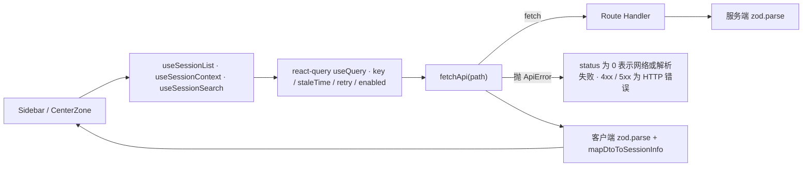

# 客户端数据获取

三个 hook、一个 fetch 包装、一个 URL 真值源。这就是浏览器侧取数的全部——没有全局状态管理、没有手写 debounce、没有手写重试。

## 链路总览



## fetchApi 与 ApiError

`lib/api-client.ts` 是所有 HTTP 调用的唯一入口，职责有三：

1. **网络层失败 → `ApiError(message, 0)`**。`status = 0` 是一个刻意的哨兵值，表示"根本没到 HTTP 层"（离线、DNS、CORS、fetch 被拒）。
2. **非 2xx → `ApiError(bodyMessage, response.status)`**。会先尝试解析响应体取 `error` / `message` 字段作为消息，解析失败则退回 `HTTP <status>`。
3. **JSON 解析失败 → `ApiError(message, 0)`**，同样归入"没到 HTTP 层"。

`ApiError` 的构造参数顺序是 **`(message, status)`**，与很多库的 `(status, message)` 相反。代码注释明确记录了这个偏离及其原因（遵循 `Error` 的通用约定），改动时注意别按惯例写反。

它不做的事：重试 / backoff（由 react-query 的 `retry` 负责）、zod 校验（由调用方做）、SSR/CSR 区分。抽这层的理由是让测试只需 mock `fetch()`，不必每个 hook 各写一遍错误映射。

## 三个 hook 的策略对比

| hook | queryKey | staleTime | retry | enabled |
|---|---|---|---|---|
| `useSessionList` | `['sessions', 'list']` | 继承全局 5min | 默认（3） | 总是 |
| `useSessionContext` | `['session', 'context', sessionId, leafId, tail]` | 30s | **1** | `Boolean(sessionId)` |
| `useSessionSearch` | `['session', 'search', query]` | 30s | 默认（3） | `query.length > 0` |

几处值得记住的设计：

- **`useSessionList` 刻意不覆盖 `staleTime`**，注释说明后续如需在创建会话后 invalidate 再按需调整。会话列表的 query key 被导出为 `SESSIONS_LIST_QUERY_KEY` 常量，供外部 `invalidateQueries` 使用。
- **`useSessionContext` 把 `leafId` 与 `tail` 放进 queryKey**，因此这两个选项变化会触发重新拉取；`tail` 默认 **50**，被写死为模块级 `DEFAULT_TAIL`。这就是 e2e 里断言 `tail=50` 的来源——客户端总是显式传这个值，route 的"默认 10000"路径在 UI 里走不到。
- **`enabled: Boolean(sessionId)`** 让 `CenterZone` 无需额外判断"未选中"与"加载中"的区别。
- **`retry: 1`** 而非默认值：注释解释为一次瞬时网络失败重试，第二次失败即上抛给 UI。注释还坦承这与 `CenterZone` 里那套"重试计数器 + 重新挂载"的做法重复了，后者是 PR.A 的遗留。
- **`useSessionSearch` 的 queryKey 含原始 query 字符串**，`enabled: false` 时空查询不发请求——这与 route 里空 `q` 直接短路的规则对齐。注释还说明 react-query 的去重取代了原先手写的 200ms debounce。

## 客户端的二次校验与反向映射

三个 hook 都在拿到响应后重新 `zod.parse`：

```ts
const parsed = ListSessionsResponseSchema.parse(response)
return parsed.sessions.map(mapDtoToSessionInfo)   // ISO string → Date
```

这是 ADR 0004 的硬性要求——**任何外部数据进入 domain 前必须 parse**。副作用是组件层拿到的仍是 SDK 的 `SessionInfo` 形状（`created` / `modified` 为 `Date`），因此 `SessionTree` 等组件可以直接接收而无需为 wire 格式写适配层。

服务端也 parse（见 [HTTP API 层](./api-routes.md)），两次校验目的不同：服务端是"保证我发出的东西合规"，客户端是"保证我收到的东西可信"。

## 选中态：URL 是唯一真值源

```
/sessions?session=<id>
```

```ts
const selectedSessionId = searchParams.get('session') ?? undefined
```

| 场景 | 行为 |
|---|---|
| Sidebar 点击行 | `router.replace('/sessions?session=...', { scroll: false })` |
| 关闭搜索 / 清空选中 | `router.replace('/sessions' + 其余 query)` |
| 页面刷新、深链 | `useSearchParams` 直接还原 |
| 浏览器前进后退 | Next.js 保留 query 状态，天然可用 |

用 `replace` 而非 `push` 是为了避免每点一次就堆一条历史记录；副作用是**点过几个会话后，浏览器后退不会逐个回到上一个会话**，而是回到进入页面前的位置。

`useSelectedSessionStore` 仍然存在并被 `Sidebar.tsx` import，但页面与 Sidebar 都不消费它——注释说明是为兼容潜在外部读取方。**新代码不要往这个 store 写选中态。**

## 错误如何到达 UI

`fetchApi` 抛出的 `ApiError` 被 react-query 捕获为 `error`，各 hook 原样透出（`useSessionSearch` 只返回 `data` / `isLoading`，不暴露 `error`）。`CenterZone` 据此渲染错误态。`ApiError.status` 目前**没有任何消费方**——hook 与组件都只用"有没有错"这个布尔信息，没有按状态码分支。

## 相关页面

- [HTTP API 层](./api-routes.md) — 这些 hook 调用的端点与错误映射
- [应用外壳](./app-shell.md) — Provider 栈与选中态的页面侧消费
- [Session 浏览 UI](./session-browsing-ui.md) — 搜索结果如何被用作列表过滤器
- [session 搜索](../core/session-search.md) — 服务端的扫描算法与上限
