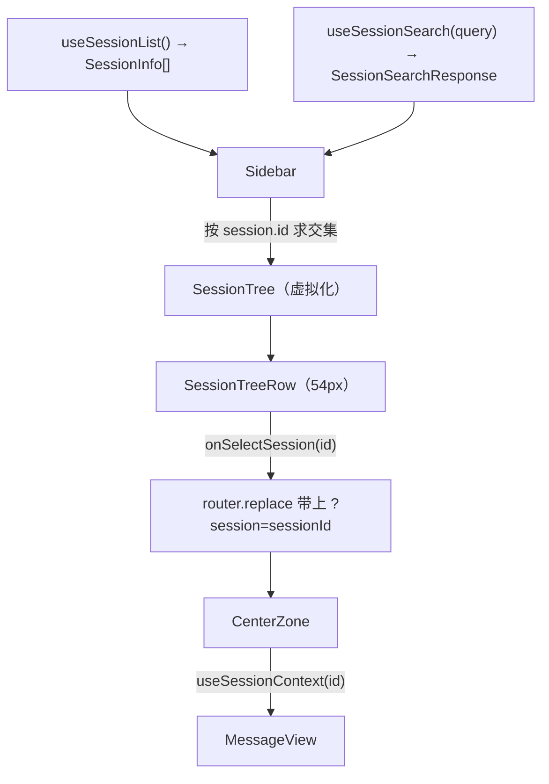

# Session 浏览 UI

这条链路从 HTTP 响应一路走到像素，并且**每个环节的 DOM 属性都被测试锁定**——改属性名等于改测试。

## 数据流



## 虚拟列表

`SessionTree` 用 `@tanstack/react-virtual`：

```ts
const virtualizer = useVirtualizer({
  count: sessions.length,
  getScrollElement: () => parentRef.current,
  estimateSize: () => SESSION_TREE_ROW_HEIGHT_PX,          // 54
  overscan: Math.ceil(SCROLL_OVERSCAN_PX / SESSION_TREE_ROW_HEIGHT_PX),  // ceil(240/54) = 5
})
```

两个易错点：

- **`overscan` 的单位是"条"不是"像素"**。`SCROLL_OVERSCAN_PX = 240` 是按像素设计的意图值，代码用除法换算成条数（4.44 → 5）。改动行高时这个换算要跟着更新。
- **`SESSION_TREE_ROW_HEIGHT_PX = 54` 是硬约定**，行组件的 Tailwind 类 `h-[54px]` 与之绑定。两处不一致会让虚拟化的位置计算错位。

外层容器高度设为 `virtualizer.getTotalSize()`，内层每行绝对定位到 `top: virtualRow.start`。因为总高度是"估算值 × 条数"，若行高真的变化会导致滚动条长度失真——固定行高是这套方案能成立的前提。

**空态**：`sessions.length === 0` 时不渲染虚拟容器，直接显示 `data-component="session-tree-empty"` 的占位（硬编码英文 "No sessions yet"，未走 i18n）。

**jsdom 下渲染 0 行**：jsdom 的 `clientHeight` 为 0，虚拟化器认为视口内没有任何行。`session-tree.test.tsx` 与 `Sidebar.test.tsx` 因此都 mock 了该库——新增涉及 SessionTree 的测试时别忘了。

## 搜索是"过滤"而不是"展示"

这是本 UI 最容易误解的一点。`Sidebar` 的注释专门解释了：

```ts
const matchedIds = new Set(searchData.results.map((r) => r.session.id))
return list.filter((s) => matchedIds.has(s.id))
```

**搜索结果只用来收窄已有的会话列表，不会展示列表之外的结果。** 理由记录在注释里：单一可滚动列表体验更一致，拆成两个面板会造成双滚动混乱；将来若要 regex/fuzzy 内联结果再改。

直接后果：服务端的搜索是**跨全部 agentDir** 的（见 [session 搜索](../core/session-search.md)），但 UI 只保留同时出现在列表里的那些。`Sidebar` 的注释记录了这个设计演进——mock 阶段两个数据源不一致导致交集为空、过滤失效，切到同一后端后才恢复正常。

关闭搜索框会同时清空 query（`handleSearchToggle` 里 `if (!next) setSearchQuery('')`），因此过滤器自动解除。

## CenterZone 的三态机

```text
selectedSessionId === undefined → 占位文案 "Select or create a session"
isLoading                      → 3 行骨架 + aria-busy
error                          → 本地化错误文案 + error.message + Retry 按钮
data                           → MessageView
```

骨架是固定的 3 行（`SKELETON_KEYS` 常量），注释说明 Phase 3+ 若要动态数量再换 `useId()`。错误态会把 `error.message` 直接显示出来——配合 route 侧"500 回传原始 message"的行为，内部错误细节会出现在 UI 上。

> ⚠️ **Retry 按钮当前是死的**。注释说明它来自 PR.A 的"重试计数器 + 重新挂载"实现，PR.B 切到 react-query 后本应换成 `query.refetch()`，但代码没有更新。点击无效果。

## MessageView 的 DOM 契约

| 属性 | 值 | 用途 |
|---|---|---|
| `data-component` | `message-view` | 容器 |
| `data-component` / `data-testid` | `message-row` | 单行（两套选择器供 e2e 与 testing-library 各用） |
| `data-message-role` | `user` / `assistant` / 其他 role | 角色判定与样式 |
| `data-entry-id` | `entryId` 或 `idx-<i>` 兜底 | 测试定位与 React key |
| `data-component` | `user-bubble` / `assistant-meta` / `assistant-bubble` | 左右对齐气泡与模型信息行 |
| `data-component` | `message-fallback` | 非 user/assistant 角色 |

**React key 用 `entryIds[i]`，缺失时退化为 `idx-<i>`**——core 保证同一 session 内 entry id 唯一，兜底只是防御。

文本提取走一个 `extractText(content)`：字符串直接用，数组则筛出 `type === 'text'` 的块用 `\n` 拼接，其余（图片、toolResult 等）返回空串。

**fallback 分支**处理 toolResult / custom / bashExecution 等角色：只显示角色名，不做类型化渲染。图片与 tool-call 渲染属 Phase 3+。这解释了为什么 e2e 断言的是"三类角色计数之和 > 0"而不是具体角色。

## 已知的不一致

- **类型双写**：`CenterZone` 在把 `data.messages` 传给 `MessageView` 时做了一次 `as unknown as` 双重断言，注释解释是 wire 类型与 MessageView 内部的 `AgentMessage` 定义不同。core 与 web 各定义了一份 `AgentMessage` 类型（web 在 `lib/agent-message-types.ts`），没有共用 barrel。
- **两套 AgentMessage 类型**：core 从 `pi-agent-core` re-export，web 自己定义了一份渲染用的结构。二者靠 `as unknown as` 桥接，而不是靠类型推导。

## 相关页面

- [客户端数据获取](./data-fetching.md) — 三个 hook 的 queryKey 与选中态
- [HTTP API 层](./api-routes.md) — 被消费的三个端点
- [session 搜索](../core/session-search.md) — 搜索结果的产生方式
- [端到端测试](../testing/e2e-playwright.md) — 本页 DOM 契约的消费者
- [单元与集成测试](../testing/unit-tests.md) — 组件测试的 mock 要点
